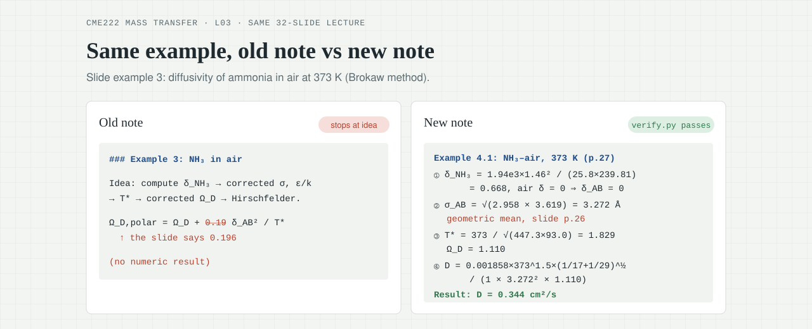

<div align="center">

<a href="https://izhengjy.github.io/claudesidian-learning-os/"></a>

# claudesidian-learning-os

**Drop in a lecture PDF, get a note that explains it properly with every example worked out. Before the exam, one sentence turns the whole course into a review vault and quizzes.**

Claude Code + Obsidian plugins

[](https://github.com/iZHENGjy/claudesidian-learning-os/actions/workflows/ci.yml)
[](CHANGELOG.md)
[](LICENSE)

[简体中文](README.md) · **English**

[Live demo](https://izhengjy.github.io/claudesidian-learning-os/) · [Real course example](examples/CME222-mass-transfer) · [Quickstart](#quickstart)

</div>

## What it does

| When | You say | You get |
|---|---|---|
| After each lecture | "ingest this lecture" + the slides | A teaching note: each concept starts with why you need it, then how it works; every slide example worked to a number |
| Doing problem sets | "solve this tutorial" | Worked solutions, cross-checked against the course's formula map |
| End of a course | "distill CME222" | The course's formulas as a numbered derivation tree |
| Before the exam | "build the review vault for CME222", then "quiz me on CME222" | A one-page formula sheet, every common mistake, a question bank by topic; quizzes record which concepts you still miss |

> Skill prompts are written in Chinese. They handle slides in any language and write notes in the language you work in.

## What a note looks like

One section from lecture 3 of the example course (mass transfer), translated from the Chinese original; slide screenshots removed:

> ### 3.2 Fuller correlation (slides p.22–24)
>
> **Why you need it**
> Benzene diffusing in air: benzene's Lennard-Jones parameters often can't be found, so the Hirschfelder equation can't be used.
>
> **How it works**
> Instead of $\sigma$ and $\varepsilon$, the Fuller correlation uses a "diffusion volume" $\Sigma v$ to stand for molecular size. Simple molecules are looked up in a table; for others, add up the atomic diffusion volumes, with a structural correction for an aromatic ring (p.23). The temperature exponent is 1.75, higher than the hard-sphere 1.5.
>
> **Example 3.2**: diffusivity of benzene in air at 30 °C and 1 atm (p.24)
>
> $$(\Sigma v)_{C_6H_6} = 6\times16.5 + 6\times1.98 - 20.2 = 90.68$$
>
> $$D_{AB} = \frac{10^{-3}\times303^{1.75}\left(\frac{1}{78} + \frac{1}{29}\right)^{1/2}}{1\times\left(90.68^{1/3} + 20.1^{1/3}\right)^2} = 0.0920\ \text{cm}^2/\text{s}$$
>
> **Result**: 0.0920 cm²/s, about 7% below the tabulated value scaled to 303 K.
>
> **Pros and cons**
> Only the molecular formula is needed, which makes it the easiest option. But Fuller and Hirschfelder both assume non-polar molecules; for polar ones like ammonia or SO₂, dipole interactions need another correction.
>
> <details><summary><b>Say it in your own words</b> (close the note, explain it, then check)</summary>
>
> Your answer should include:
> - [ ] diffusion volume replaces the Lennard-Jones parameters
> - [ ] diffusion volumes add up by atom, with a correction for aromatic rings
> - [ ] temperature exponent 1.75, no collision integral needed
>
> One way to say it: if you can't find a molecule's "collision parameters", estimate its size another way — add up a volume score for each atom, take a bit off for rings. With size, mass, temperature and pressure you can compute the diffusivity directly.
> </details>

Every lecture is written this way: the open problem left at the end of one section is where the next section's "why you need it" starts. Each part ends with common misconceptions (with numeric counterexamples) and a prediction question. [Full note (Chinese) →](examples/CME222-mass-transfer/vault/CME222_传质/L03_diffusion_coefficient_estimation.md)

## Before the exam: review vault and quizzes

The whole course becomes one review vault. Each question is tagged by type, has a folded answer, and links back to the section it tests:

> **Q2 [recall] When is the diffusivity symmetric?**
> Under what condition does $D_{AB} = D_{BA}$ hold?
>
> <details><summary>Answer</summary>A binary system at constant total molar concentration (for gases: constant T and P). Tests: L03 §1.2</details>

Say "quiz me on CME222" and each round asks 4 multiple-choice questions; missed concepts are recorded with the reason:

| Concept | Tried | Right | Status |
|---|:---:|:---:|---|
| Temperature dependence in Fuller | 1 | 1 | 🟢 |
| How σ_AB is combined in Brokaw | 1 | 0 | 🔴 used the arithmetic mean from the non-polar equation; Brokaw uses the geometric mean |
| Pressure in table J.1 | 1 | 0 | 🔴 read the $D_{AB}P$ column as $D_{AB}$ |

## How it differs from asking an AI for notes

<p align="center"></p>

Ask an AI to summarise slides and examples tend to stop at "the idea is…", with a coefficient copied slightly wrong — it reads fine, so nobody notices. Here, a note isn't done until it passes a check script:

- **Examples are worked to the end**, and every number goes into a `verify.py` with asserts. If a check fails, the note is fixed, not the assert.
- **Formula constants are checked against the slide text.** The old note above wrote 0.19 for 0.196; if the note and its check script copy the same mistake, only the slide text catches it.
- **Every slide is covered**, or skipped with a stated reason.
- **Anything beyond the slides needs a source**, or is marked "to verify".

Same lecture, before and after: examples worked to a number 0/4 → 4/4, formula errors 1 → 0, dead links 10 → 0. [Full example and commands to reproduce →](examples/CME222-mass-transfer)

## Quickstart

You need [Claude Code](https://claude.com/claude-code), an Obsidian vault, Python 3.10+, and a free [MinerU](https://mineru.net) token (it turns PDF slides into text).

```bash
pip install requests PyMuPDF Pillow python-pptx python-dotenv rich pyyaml
```

Create `.env` at the vault root with `MINERU_API_TOKEN=<your token>`. Then, in Claude Code inside the vault:

```text
/plugin marketplace add iZHENGjy/claudesidian-learning-os
/plugin install claudesidian-notes@claudesidian-learning-os
```

Drop in some slides and say "ingest this lecture". Notes go to `01_Projects/<CODE>_<course name>/`; course names can be in any language.

## What's inside

| Plugin | For |
|---|---|
| [`claudesidian-notes`](plugins/claudesidian-notes) | The core: lecture notes, tutorials, formula map, review vault, quizzes, plus paper notes |
| [`chemeng-coursework`](plugins/chemeng-coursework) | A chemical-engineering homework coach, and the example of adding rules for your own field |
| [`paper-review-toolkit`](plugins/paper-review-toolkit) | For literature reviews: pulls data from papers into one master spreadsheet |

The core plugin has no subject knowledge built in; the author has used it unchanged for engineering, economics, computer-science and physics courses. To add rules for your own field, follow [`docs/PLUGIN_SPEC.md`](docs/PLUGIN_SPEC.md).

## Notes

- The checks make sure numbers are computed right, formulas are copied right and every slide is covered. Citations can only be checked for being present, not for being true, so the notes are still worth a read-through.
- How consistent quality is across repeated runs on the same slides hasn't been measured yet.

## Credits

Grew out of a vault built on [claudesidian](https://github.com/heyitsnoah/claudesidian); PDF extraction by [MinerU](https://github.com/opendatalab/MinerU); the teaching-note structure borrows from [Love Learning Anything](https://github.com/RAIZ-Zzz/love-learning-anything), the review vault and quiz from [tutor-skills](https://github.com/RoundTable02/tutor-skills). The example course's slides are not included.

[Changelog](CHANGELOG.md) · [Contributing](CONTRIBUTING.md) · [MIT License](LICENSE)
