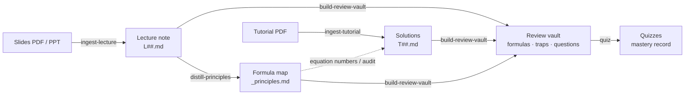

<div align="center">

<a href="https://izhengjy.github.io/claudesidian-learning-os/"></a>

# claudesidian-learning-os

**Carry a course from the first lecture to the final exam inside Obsidian: slides → teaching notes → tutorial solutions → formula map → review vault → quizzes.**

Claude Code plugins · any subject · slides in any language

[](https://github.com/iZHENGjy/claudesidian-learning-os/actions/workflows/ci.yml)
[](CHANGELOG.md)
[](LICENSE)

[简体中文](README.md) · **English**

[Live demo](https://izhengjy.github.io/claudesidian-learning-os/) · [Example course](examples/CME222-mass-transfer) · [Quickstart](#quickstart)

</div>

---

**Contents**

- [A semester, step by step](#a-semester-step-by-step)
- [A course folder when it's done](#a-course-folder-when-its-done)
- [How each note is built](#how-each-note-is-built)
  - [Lecture note L##](#lecture-note-l)
  - [Tutorial solutions T##](#tutorial-solutions-t)
  - [Formula map _principles](#formula-map-_principles)
  - [Review vault and quizzes](#review-vault-and-quizzes)
- [Quality checks](#quality-checks)
- [Repository layout](#repository-layout)
- [Quickstart](#quickstart)
- [Commands](#commands)
- [Adding a plugin for your field](#adding-a-plugin-for-your-field)

---

## A semester, step by step



| When | You say | You get |
|---|---|---|
| After each lecture | "ingest this lecture" + the slides | A lecture note `L##.md` with its own check script |
| Doing problem sets | "solve this tutorial" | Solutions `T##.md`, citing the formula map's equation numbers |
| After a block of lectures | "distill CME222" | A formula map `_principles.md`: the course's formulas arranged as a derivation tree |
| Before the exam | "build the review vault for CME222" | `复习库/` (review vault): formula sheet, common mistakes, question bank by topic |
| Again and again | "quiz me on CME222" | Rounds of 4 multiple-choice questions + an optional explain-it-back, mastery tracked per concept |

## A course folder when it's done

Everything for one course lives in one folder. File names below come from the example course [CME222 Mass Transfer](examples/CME222-mass-transfer); the example repo includes the notes, `index.md` and the review vault, but not the slide text, `manifest.md` or the formula map.

```text
01_Projects/CME222_传质/
├── index.md                              course map: one section per week, linking that week's notes and pitfalls
├── manifest.md                           slide inventory: processing status and note link for each PDF
├── L01_intro_to_mass_transfer.md         lecture notes, one per lecture
├── L02_diffusive_mass_transfer.md
├── L03_diffusion_coefficient_estimation.md
├── L04_liquid_solid_pore_diffusivity.md
├── T01_membrane_diffusion.md             tutorial solutions, one per problem set
├── T02_diffusion_estimation_problems.md
├── T03_liquid_solid_pore_diffusion_problems.md
├── _principles.md                        formula map
├── 复习库/                                review vault
│   ├── 00-总览.md                         overview: topic map + mastery dashboard
│   ├── 01-公式速查.md                      one-page formula sheet
│   ├── 02-易错点.md                        every common mistake in the course
│   ├── 题库/<topic>.md                     10 questions per topic, answers folded
│   ├── 掌握度/<topic>.md                   right/wrong counts and reasons per concept
│   └── verify.py                          checks every numeric answer in the question bank
└── _attachments/
    ├── source/                            original slides (not committed)
    └── <slide deck>/
        ├── full.md                        text and formulas extracted from the PDF
        ├── images/                        slide images, named course_lecture_page_topic
        └── verify.py                      check script for every example in this lecture
```

## How each note is built

### Lecture note L##

One per lecture, written so you can understand the lecture without the slides. This is the actual structure of [L03](examples/CME222-mass-transfer/vault/CME222_传质/L03_diffusion_coefficient_estimation.md) (32 slides, 4 parts, 8 concepts):

```text
L03_diffusion_coefficient_estimation.md
├── frontmatter            course, week, slide range, skipped slides and why, check result
├── At a glance            ≤ 3 sentences: what problem this lecture solves
├── Reading path           slide pages per part + one question you can answer after it
├── Prerequisites          knowledge used but not taught here: assumed, or covered in which section
│
├── Part 1 · What a diffusion coefficient is
│   ├── 1.1 Dimension and magnitude (p.4–8)      ← every concept has the same 7 parts, see below
│   ├── 1.2 Equality of binary coefficients (p.9)
│   ├── Misconceptions     wrong ideas students hold confidently: counterexample → why it's wrong → correct statement
│   └── Pause              one "why" question + a prediction question in a new situation
├── Part 2 · Deriving D from molecular motion      2.1 self-diffusion · 2.2 collision diameter and binary mixtures
├── Part 3 · Two practical estimates               3.1 Hirschfelder equation · 3.2 Fuller correlation
├── Part 4 · Polar gases and multicomponent mixtures   4.1 Brokaw equation · 4.2 Wilke equation
│
├── Review and practice
│   ├── Summary            one line per concept: a sentence + the key formula
│   ├── Exercises (10)     mostly "why" questions, at least 2 linking two concepts, answers folded
│   ├── Glossary           Chinese–English terms
│   └── References         only sources actually cited and checked
├── Your notes             left for you; the AI doesn't write here
└── Slide transcript (folded)   key points of every slide, so coverage can be traced
```

Every concept (`###` section) follows the same order:

| Part | What goes in it |
|---|---|
| Why you need it | Where you'd get stuck without it: a concrete situation, never opening with a term or formula |
| How it works | A connected explanation from input to output, using the slide's own example |
| On the slides | The slide's definitions and points; formulas numbered |
| Example | The slide's worked example step by step, to the quantity and unit asked for |
| In practice | How practitioners say it, in Chinese and English |
| Pros and cons | Its last sentence leaves the problem the next section's "why you need it" picks up |
| In your own words | A folded self-check: 3 points you must mention + one model answer |

<details>
<summary><b>See a real concept: L03 §3.2 Fuller correlation (translated)</b></summary>

<br>

> **Why you need it**
> Benzene diffusing in air: benzene's Lennard-Jones parameters often can't be found, so the Hirschfelder equation can't be used.
>
> **How it works**
> Instead of $\sigma$ and $\varepsilon$, the Fuller correlation uses a "diffusion volume" $\Sigma v$ to stand for molecular size. Simple molecules are looked up in a table; for others, add up the atomic diffusion volumes, with a structural correction for an aromatic ring (p.23). The temperature exponent is 1.75, higher than the hard-sphere 1.5.
>
> **On the slides** (p.22–23)
>
> $$D_{AB} = \frac{10^{-3}\,T^{1.75}\left(\frac{1}{M_A} + \frac{1}{M_B}\right)^{1/2}}{P\left[(\Sigma v)_A^{1/3} + (\Sigma v)_B^{1/3}\right]^2} \tag{3.3}$$
>
> **Example 3.2**: diffusivity of benzene in air at 30 °C and 1 atm (p.24)
>
> $$(\Sigma v)_{C_6H_6} = 6\times16.5 + 6\times1.98 - 20.2 = 90.68$$
>
> $$D_{AB} = \frac{10^{-3}\times303^{1.75}\left(\frac{1}{78} + \frac{1}{29}\right)^{1/2}}{1\times\left(90.68^{1/3} + 20.1^{1/3}\right)^2} = 0.0920\ \text{cm}^2/\text{s}$$
>
> **Result**: 0.0920 cm²/s, about 7% below the tabulated value scaled to 303 K.
>
> **In practice**: when Lennard-Jones parameters are unavailable, use the Fuller correlation with additive atomic diffusion volumes.
>
> **Pros and cons**
> Only the molecular formula is needed, which makes it the easiest option. But Fuller and Hirschfelder both assume non-polar molecules; for polar ones like ammonia or SO₂, dipole interactions need another correction.
>
> **In your own words**　your answer should include:
> - [ ] diffusion volume replaces the Lennard-Jones parameters
> - [ ] diffusion volumes add up by atom, with a correction for aromatic rings
> - [ ] temperature exponent 1.75, no collision integral needed

That last "needs another correction" is exactly the "why you need it" of the next section, 4.1 Brokaw equation.

</details>

### Tutorial solutions T##

One per problem set, written so you can solve it and write it up in an exam:

```text
T02_diffusion_estimation_problems.md
├── Formulas for this set      formulas used, cited by formula-map number (X.Y)
├── Data and constants         values + sources; anything not found is marked "please verify", never made up
├── Problem 1 … N
│   ├── original question + translation + formulas used
│   ├── Solution               one chain of reasoning: estimate the magnitude first, explain each step, final answer with units
│   ├── English Concise Answer   100–200 words of full sentences, ready for an English exam paper
│   ├── Pitfalls
│   └── Variants (optional)    how the answer changes if a condition changes
├── Answer table               problem → final answer → concepts involved
├── Gaps identified            weak concepts the problems exposed, linked back to the lectures
└── Feedback for the formula map   formulas used here that the map is missing or gets wrong
```

### Formula map _principles

One per course: every lecture's formulas arranged by how they derive from each other, so you can see where each one comes from:

```text
_principles.md
├── Nomenclature            Roman / Greek / sub- and superscripts, each in Chinese and English, look-alike symbols flagged
├── §1 Starting points      conservation laws or axioms, equations (1.1), (1.2)…
├── §2 … §N Derived results each says which equation it comes from and under what assumptions, with numbered steps
└── Equation index          number → section
```

Equation numbers run continuously through the course; tutorial solutions and the review vault cite them.

### Review vault and quizzes

The whole course condensed into a review vault. It only reorganises existing notes; nothing new is added:

```text
复习库/  (review vault)
├── 00-总览.md          overview: topic map (topic → which lectures) + mastery dashboard
├── 01-公式速查.md       one-page formula sheet: formula · meaning · when it applies, ending with "5 to memorise"
├── 02-易错点.md         every misconception in the course: what's wrong + what to do instead + source link
├── 题库/<topic>.md      ≥ 10 questions per topic, tagged recall / application / analysis, answers folded, linked to source sections
├── 掌握度/<topic>.md    updated automatically by quizzes
└── verify.py           checks every numeric answer in the question bank
```

A question-bank entry:

> **Q2 [recall] When is the diffusivity symmetric?**
> Under what condition does $D_{AB} = D_{BA}$ hold?
>
> <details><summary>Answer</summary>A binary system at constant total molar concentration (for gases: constant T and P). Tests: L03 §1.2</details>

Say "quiz me on CME222", choose what this round covers (untested topics, the weakest topic, or your pick), and answer 4 multiple-choice questions. Missed concepts are recorded with the reason and asked again in a new situation next round:

| Concept | Tried | Right | Status |
|---|:---:|:---:|---|
| Temperature dependence in Fuller | 1 | 1 | 🟢 |
| How σ_AB is combined in Brokaw | 1 | 0 | 🔴 used the arithmetic mean from the non-polar equation; Brokaw uses the geometric mean |
| Pressure in table J.1 | 1 | 0 | 🔴 read the $D_{AB}P$ column as $D_{AB}$ |

## Quality checks

A lecture note isn't done until it passes [`check_note.py`](plugins/claudesidian-notes/shared/scripts/check_note.py):

| Check | What it looks at |
|---|---|
| Numbers | Runs the lecture's `verify.py`; every example has a matching block; every result in the note appears in an assert, in the same unit |
| Slide text | Every constant in a numbered formula must be found in the slide text; where the slide prints an answer, the check must match it |
| Coverage | Every slide is cited by a section or skipped with a stated reason |
| Structure | Each concept opens with a concrete problem; misconceptions have numeric counterexamples; each part has a prediction question; ≥ 8 exercises; no links to notes that don't exist |
| Sources | Anything beyond the slides is cited or marked "to verify" |

The checker itself has [48 tests](tests) that run on every push in CI.

## Repository layout

```text
claudesidian-learning-os/
├── .claude-plugin/marketplace.json      plugin marketplace entry
├── plugins/
│   ├── claudesidian-notes/              the core plugin
│   │   ├── skills/
│   │   │   ├── ingest-lecture/          slides → lecture note
│   │   │   ├── ingest-tutorial/         problem set → solutions
│   │   │   ├── distill-principles/      all lecture notes → formula map
│   │   │   ├── build-review-vault/      notes → review vault
│   │   │   ├── quiz/                    review vault → quizzes
│   │   │   └── ingest-paper/            research paper PDF → searchable markdown
│   │   │       each skill: SKILL.md workflow · assets/ note templates · references/ writing rules and lessons learned
│   │   ├── commands/                    /distill-all  /audit-tutorials
│   │   └── shared/
│   │       ├── assets/manifest-example.md   slide inventory template
│   │       └── scripts/
│   │           ├── mineru_extract.py        PDF slides → text + formulas + images
│   │           ├── extract_images.py        one image per slide, for page-by-page checking
│   │           ├── check_note.py            lecture-note checker
│   │           ├── extract_formulas.py      lists every formula in a course
│   │           ├── validate_principles.py   formula-map self-check
│   │           ├── reverse_audit.py         audits tutorial solutions against the formula map
│   │           └── mineru_convert.py · process_si.py   paper and supplementary-file conversion
│   ├── chemeng-coursework/              chemical-engineering homework coach (example domain plugin)
│   └── paper-review-toolkit/            literature reviews: pull paper data into one spreadsheet
├── examples/CME222-mass-transfer/       a real course run through the pipeline
├── tests/                               tests for check_note.py
└── docs/                                demo site · plugin spec PLUGIN_SPEC.md
```

## Quickstart

You need [Claude Code](https://claude.com/claude-code), an Obsidian vault, Python 3.10+, and a free [MinerU](https://mineru.net) token (it turns PDF slides into text).

```bash
pip install requests PyMuPDF Pillow python-pptx python-dotenv rich pyyaml
```

Create `.env` at the vault root with `MINERU_API_TOKEN=<your token>`. Then, in Claude Code inside the vault:

```text
/plugin marketplace add iZHENGjy/claudesidian-learning-os
/plugin install claudesidian-notes@claudesidian-learning-os
```

Drop in some slides and say "ingest this lecture". The first time for a course, it asks for the course code and name and creates `01_Projects/<CODE>_<course name>/`; the name can be in any language.

## Commands

| Say | Skill / command | Output |
|---|---|---|
| "ingest this lecture" / "process these slides" | `ingest-lecture` | `L##_<topic>.md` + `verify.py`; updates `index.md` and `manifest.md` |
| "solve this tutorial" | `ingest-tutorial` | `T##_<topic>.md` |
| "distill CME222" | `distill-principles` | `_principles.md` |
| "build the review vault for CME222" | `build-review-vault` | `复习库/` |
| "quiz me on CME222" | `quiz` | a quiz round; updates `掌握度/` |
| "ingest this paper" | `ingest-paper` | `main.md`, `si.md` and figures named by figure number, in the paper's folder |
| "generate the full index" | `ingest-lecture` | at the end of term, rewrites `index.md` as a complete course map |
| `/distill-all` | command | builds a formula map for every course that doesn't have one |
| `/audit-tutorials CME222` | command | audits all of a course's tutorial solutions against its formula map |

## Adding a plugin for your field

The core plugin has no subject knowledge built in; the author has used it unchanged for engineering, economics, computer-science and physics courses. When a field has its own plots, handbooks or report formats, put them in a separate domain plugin — [`chemeng-coursework`](plugins/chemeng-coursework) is the chemical-engineering example. See [`docs/PLUGIN_SPEC.md`](docs/PLUGIN_SPEC.md).

## Notes

- Skill prompts are written in Chinese. They handle slides in any language and write notes in the language you work in.
- The checks make sure numbers are computed right, formulas copied right and every slide covered. Citations can only be checked for being present, not for being true, so the notes are still worth a read-through.
- The example course doesn't include the original slides.

## Credits

Grew out of a vault built on [claudesidian](https://github.com/heyitsnoah/claudesidian); PDF extraction by [MinerU](https://github.com/opendatalab/MinerU); the teaching-note structure borrows from [Love Learning Anything](https://github.com/RAIZ-Zzz/love-learning-anything), the review vault and quiz from [tutor-skills](https://github.com/RoundTable02/tutor-skills).

[Changelog](CHANGELOG.md) · [Contributing](CONTRIBUTING.md) · [MIT License](LICENSE)
