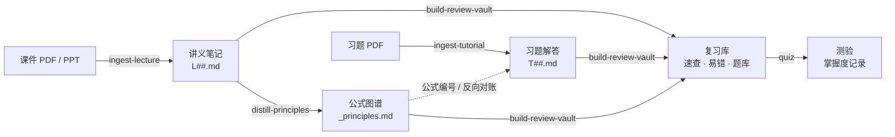

<div align="center">

<a href="https://izhengjy.github.io/claudesidian-learning-os/"></a>

# claudesidian-learning-os

**在 Obsidian 里把一门课从第一节课串到期末考：课件 → 讲解型笔记 → 习题解答 → 公式图谱 → 复习库 → 测验。**

Claude Code 插件 · 任何学科 · 任何语言的课件

[](https://github.com/iZHENGjy/claudesidian-learning-os/actions/workflows/ci.yml)
[](CHANGELOG.md)
[](LICENSE)

**简体中文** · [English](README.en.md)

[在线展示](https://izhengjy.github.io/claudesidian-learning-os/) · [示例课程](examples/CME222-mass-transfer) · [快速上手](#快速上手)

</div>

---

**目录**

- [一学期的流程](#一学期的流程)
- [一门课生成后的样子](#一门课生成后的样子)
- [笔记的完整架构](#笔记的完整架构)
  - [讲义笔记 L##](#讲义笔记-l)
  - [习题解答 T##](#习题解答-t)
  - [公式图谱 _principles](#公式图谱-_principles)
  - [复习库与测验](#复习库与测验)
- [质量检查](#质量检查)
- [项目结构](#项目结构)
- [快速上手](#快速上手)
- [命令速查](#命令速查)
- [给自己的专业加插件](#给自己的专业加插件)

---

## 一学期的流程



| 阶段 | 你说 | 得到 |
|---|---|---|
| 每节课后 | "整理这节课" + 课件 | 一份讲义笔记 `L##.md`，配一个验算脚本 |
| 做习题时 | "解这份 tutorial" | 习题解答 `T##.md`，公式引用公式图谱的编号 |
| 学完一部分 | "蒸馏 CME222" | 公式图谱 `_principles.md`：整门课的公式按推导关系排成树 |
| 考前 | "做 CME222 的复习库" | `复习库/`：公式速查、易错点合集、按主题的题库 |
| 考前反复 | "考我 CME222" | 每轮 4 道选择题 + 可选 1 道复述题，按概念记录掌握度 |

## 一门课生成后的样子

一门课处理完后，所有产出都在一个文件夹里（文件名取自示例课程 [CME222 传质](examples/CME222-mass-transfer)；示例仓库只收了笔记、`index.md` 和复习库，课件原文、`manifest.md` 和公式图谱没有放进去）：

```text
01_Projects/CME222_传质/
├── index.md                              课程地图：每周一段，链接本周笔记 + 本周易错
├── manifest.md                           课件清单：每份 PDF 的处理状态和笔记链接
├── L01_intro_to_mass_transfer.md         讲义笔记，每讲一份
├── L02_diffusive_mass_transfer.md
├── L03_diffusion_coefficient_estimation.md
├── L04_liquid_solid_pore_diffusivity.md
├── T01_membrane_diffusion.md             习题解答，每份 tutorial 一份
├── T02_diffusion_estimation_problems.md
├── T03_liquid_solid_pore_diffusion_problems.md
├── _principles.md                        公式图谱
├── 复习库/
│   ├── 00-总览.md                         主题地图 + 掌握度看板
│   ├── 01-公式速查.md                      考前一页纸
│   ├── 02-易错点.md                        全课误区合集
│   ├── 题库/<主题>.md                      每个主题 10 题，答案折叠
│   ├── 掌握度/<主题>.md                    每个概念的对错次数和错因
│   └── verify.py                          题库计算题答案的验算
└── _attachments/
    ├── source/                            原始课件（不进 git）
    └── <课件名>/
        ├── full.md                        从 PDF 抽出的课件文字和公式
        ├── images/                        课件图片，按"课程_讲次_页码_主题"命名
        └── verify.py                      这一讲所有例题的验算脚本
```

## 笔记的完整架构

### 讲义笔记 L##

一讲一份，目的是第一次学的时候能脱离课件读懂。下面是 [L03 的真实结构](examples/CME222-mass-transfer/vault/CME222_传质/L03_diffusion_coefficient_estimation.md)（32 页课件，4 个部分，8 个知识点）：

```text
L03_diffusion_coefficient_estimation.md
├── frontmatter            课程、周次、课件页码范围、跳过的页及理由、验算结果
├── 一眼看懂                ≤ 3 句话：这讲解决什么问题、得到什么
├── 阅读路线                每部分对应的课件页码 + 读完能回答的一个问题
├── 前置知识                用到但本讲没讲的知识：默认已掌握，或在哪一节补充
│
├── 第 1 部分 · 扩散系数是什么
│   ├── 1.1 扩散系数的量纲与量级（p.4–8）      ← 每个知识点固定 7 段，见下表
│   ├── 1.2 二元扩散系数相等（p.9）
│   ├── 误区与陷阱          学生会理直气壮持有的错误说法：反例 → 为什么不对 → 正确说法
│   └── 暂停                一个"为什么"问题 + 一道新情境的预测题
├── 第 2 部分 · 从分子运动推出 D               2.1 自扩散系数 · 2.2 碰撞直径与二元混合物
├── 第 3 部分 · 两个实用估算式                 3.1 Hirschfelder 方程 · 3.2 Fuller 关联式
├── 第 4 部分 · 极性气体与多组分混合物          4.1 Brokaw 方程 · 4.2 Wilke 方程
│
├── 复习与练习
│   ├── 本讲小结            每个概念一行：一句话 + 关键公式
│   ├── 练习（10 题）       多数问"为什么"，至少 2 题连接两个概念，答案折叠
│   ├── 术语中英对照
│   └── 参考文献            只列正文补充内容真实引用、核对过的资料
├── 个人补充                留给你自己写，AI 不填
└── PPT 原文（折叠）         逐页要点，保证每页都能追溯
```

每个知识点（`###` 小节）都按同一顺序写：

| 段落 | 写什么 |
|---|---|
| 为什么需要它 | 不懂它会卡在哪：一个具体场景，不以术语或公式开头 |
| 它怎么工作 | 连贯讲解，从输入走到输出，用课件自己的例子 |
| 课件里的概念 | 课件的定义和要点，公式统一编号 |
| 实例 | 课件例题逐步代数，算到题目问的量和单位 |
| 专业说法 | 一两句从业者的说法，中英对照 |
| 优缺点 | 最后一句留下的问题，正好是下一节"为什么需要它"的开头 |
| 用自己的话说 | 折叠的自测：3 个必须讲到的环节 + 一段参考说法 |

<details>
<summary><b>看一个真实的知识点：L03 §3.2 Fuller 关联式</b></summary>

<br>

> **为什么需要它**
> 苯在空气里扩散，苯的 Lennard-Jones 参数不一定查得到，Hirschfelder 方程用不了。
>
> **它怎么工作**
> Fuller 关联式不用 $\sigma$ 和 $\varepsilon$，改用"扩散体积" $\Sigma v$ 代表分子的大小。简单分子的扩散体积直接查表；表里没有的分子，按它含有的原子把原子扩散体积加起来，有芳香环再加一个结构修正（p.23）。温度指数是 1.75，比硬球的 1.5 大。
>
> **课件里的概念**（p.22–23）
>
> $$D_{AB} = \frac{10^{-3}\,T^{1.75}\left(\frac{1}{M_A} + \frac{1}{M_B}\right)^{1/2}}{P\left[(\Sigma v)_A^{1/3} + (\Sigma v)_B^{1/3}\right]^2} \tag{3.3}$$
>
> **实例 3.2**：30 °C、1 atm 下苯在空气中的扩散系数（p.24）
>
> $$(\Sigma v)_{C_6H_6} = 6\times16.5 + 6\times1.98 - 20.2 = 90.68$$
>
> $$D_{AB} = \frac{10^{-3}\times303^{1.75}\left(\frac{1}{78} + \frac{1}{29}\right)^{1/2}}{1\times\left(90.68^{1/3} + 20.1^{1/3}\right)^2} = 0.0920\ \text{cm}^2/\text{s}$$
>
> **计算结果**：0.0920 cm²/s，比表值换算结果低约 7%。
>
> **专业说法**：缺 Lennard-Jones 参数时用 Fuller 关联式，按原子扩散体积加和。*EN: When Lennard-Jones parameters are unavailable, use the Fuller correlation with additive atomic diffusion volumes.*
>
> **优缺点**
> 只需要分子式就能算，最方便。但 Fuller 和 Hirschfelder 都针对非极性分子；遇到氨、SO₂ 这样的极性分子，分子间还有偶极作用，需要再修正。
>
> **用自己的话说**　你的回答应包含：
> - [ ] 用扩散体积代替 Lennard-Jones 参数
> - [ ] 扩散体积可以按原子加和，芳香环有结构修正
> - [ ] 温度指数 1.75，不需要碰撞积分

最后一句"需要再修正"，就是下一节 4.1 Brokaw 方程的"为什么需要它"。

</details>

### 习题解答 T##

一份 tutorial 一份，目的是会做、能写进考卷：

```text
T02_diffusion_estimation_problems.md
├── 本次公式速查            本次用到的公式，引用公式图谱的编号 (X.Y)
├── 本次数据与常数          数值 + 来源；查不到的标"请核实"，不编造
├── Problem 1 … N
│   ├── 原题 + 中文翻译 + 用到的公式
│   ├── 解答                一条推导链：先估量级，每一步写为什么，最终答案带单位
│   ├── English Concise Answer   100–200 词完整句子，可直接写进英文考卷
│   ├── 易错
│   └── 变式（可选）        条件改了答案怎么变
├── 答案速查                题号 → 最终答案 → 涉及概念
├── 知识盲区                做题暴露出的薄弱概念，链接回讲义
└── 给公式图谱的反馈        用到但公式图谱里缺的或写错的公式
```

### 公式图谱 _principles

整门课一份，把所有讲义的公式按推导关系排成树，方便看清"哪个公式从哪来"：

```text
_principles.md
├── 符号说明                Roman / Greek / 上下标，每个符号中英对照，易混符号单独提醒
├── §1 根本起点             守恒定律或基本公理，公式编号 (1.1)、(1.2)…
├── §2 … §N 派生公式        每节写明由哪个公式、在什么假设下推出，推导分步编号
└── 公式索引                编号 → 所在小节
```

公式编号整门课连续，习题解答和复习库都用这个编号引用。

### 复习库与测验

整门课压成复习库，只整理已有笔记，不加新内容：

```text
复习库/
├── 00-总览.md          主题地图（主题 → 来自哪几讲）+ 掌握度看板
├── 01-公式速查.md       必背公式一页纸：公式 · 含义 · 适用条件，最后是"考前必背 5 条"
├── 02-易错点.md         全课误区合集，每条：错在哪 + 正确做法 + 出处链接
├── 题库/<主题>.md       每个主题 ≥ 10 题，标注记忆 / 应用 / 分析，答案折叠，链接回出处小节
├── 掌握度/<主题>.md     由测验自动更新
└── verify.py           题库里所有计算题答案的验算
```

一道题库题：

> **第 2 题 [记忆] 对称性的前提**
> $D_{AB} = D_{BA}$ 成立的条件是什么？
>
> <details><summary>看答案</summary>二元体系、总摩尔浓度不变（气体即恒温恒压）。考点：L03 §1.2</details>

说"考我 CME222"，先选这轮考什么（未测的主题、最弱的主题或自选），然后出 4 道选择题。答错的概念连同错因记进掌握度，下一轮换个情境再考：

| 概念 | 作答 | 答对 | 状态 |
|---|:---:|:---:|---|
| Fuller 的温度依赖 | 1 | 1 | 🟢 |
| Brokaw 中 σ_AB 的组合方式 | 1 | 0 | 🔴 沿用了非极性方程的算术平均，应为几何平均 |
| 表 J.1 的压力换算 | 1 | 0 | 🔴 把表中 $D_{AB}P$ 一列直接当成了 $D_{AB}$ |

## 质量检查

每份讲义笔记写完后，要通过 [`check_note.py`](plugins/claudesidian-notes/shared/scripts/check_note.py) 才算完成：

| 检查 | 内容 |
|---|---|
| 数字 | 实际运行这一讲的 `verify.py`；每道例题有对应的验算段；笔记里的每个计算结果都要出现在断言里，单位一致 |
| 课件原文 | 编号公式里的每个常数都要能在课件原文里找到；课件印了答案的，验算结果要和答案一致 |
| 覆盖 | 课件每一页要么被某节引用，要么写明理由跳过 |
| 结构 | 每个知识点从具体问题讲起；误区有带数字的反例；每部分有预测题；练习 ≥ 8 题；没有指向不存在笔记的链接 |
| 出处 | 课件以外的内容要标出处，查不到的标"待核实" |

检查脚本本身有 [48 个测试](tests)，每次推送都在 CI 上跑。

## 项目结构

```text
claudesidian-learning-os/
├── .claude-plugin/marketplace.json      插件市场入口
├── plugins/
│   ├── claudesidian-notes/              主体插件
│   │   ├── skills/
│   │   │   ├── ingest-lecture/          课件 → 讲义笔记
│   │   │   ├── ingest-tutorial/         习题 → 习题解答
│   │   │   ├── distill-principles/      全部讲义 → 公式图谱
│   │   │   ├── build-review-vault/      笔记 → 复习库
│   │   │   ├── quiz/                    复习库 → 测验
│   │   │   └── ingest-paper/            论文 PDF → 可检索的 markdown
│   │   │       每个 skill：SKILL.md 流程 · assets/ 笔记模板 · references/ 写作规则和踩坑记录
│   │   ├── commands/                    /distill-all  /audit-tutorials
│   │   └── shared/
│   │       ├── assets/manifest-example.md   课件清单模板
│   │       └── scripts/
│   │           ├── mineru_extract.py        PDF 课件 → 文字 + 公式 + 图片
│   │           ├── extract_images.py        课件逐页截图，供逐页核对
│   │           ├── check_note.py            讲义笔记检查
│   │           ├── extract_formulas.py      扫出整门课的所有公式
│   │           ├── validate_principles.py   公式图谱自检
│   │           ├── reverse_audit.py         习题解答和公式图谱对账
│   │           └── mineru_convert.py · process_si.py   论文正文和补充材料转换
│   ├── chemeng-coursework/              化工作业助手（领域插件示范）
│   └── paper-review-toolkit/            文献综述：论文数据抽进一张总表
├── examples/CME222-mass-transfer/       一门真实课程的完整产出
├── tests/                               check_note.py 的测试
└── docs/                                在线展示页 · 插件规范 PLUGIN_SPEC.md
```

## 快速上手

需要：[Claude Code](https://claude.com/claude-code)、一个 Obsidian vault、Python 3.10+、免费的 [MinerU](https://mineru.net) token（用来把 PDF 课件转成文字）。

```bash
pip install requests PyMuPDF Pillow python-pptx python-dotenv rich pyyaml
```

在 vault 根目录建 `.env`，写一行 `MINERU_API_TOKEN=你的token`。然后在 vault 里打开 Claude Code：

```text
/plugin marketplace add iZHENGjy/claudesidian-learning-os
/plugin install claudesidian-notes@claudesidian-learning-os
```

丢一份课件说"整理这节课"。第一次处理一门课时会问课程代码和课名，然后建好 `01_Projects/<课程代码>_<课名>/`，课名用什么语言都可以。

## 命令速查

| 你说 | skill / 命令 | 产出 |
|---|---|---|
| "整理这节课" / "处理这份 PPT" | `ingest-lecture` | `L##_<主题>.md` + `verify.py`，更新 `index.md`、`manifest.md` |
| "解这份 tutorial" / "做这份习题" | `ingest-tutorial` | `T##_<主题>.md` |
| "蒸馏 CME222" / "把这门课读薄" | `distill-principles` | `_principles.md` |
| "做 CME222 的复习库" | `build-review-vault` | `复习库/` |
| "考我 CME222" / "刷题" | `quiz` | 一轮测验，更新 `掌握度/` |
| "整理这篇论文" | `ingest-paper` | 论文文件夹里的 `main.md`、`si.md`、按图号命名的图片 |
| "生成完整 index" | `ingest-lecture` | 结课时把 `index.md` 整理成完整的课程地图 |
| `/distill-all` | 命令 | 给所有还没有公式图谱的课程批量生成 |
| `/audit-tutorials CME222` | 命令 | 一门课所有习题解答和公式图谱批量对账 |

## 给自己的专业加插件

主体插件不含任何专业知识，作者在工科、经济学、计算机、物理课上都直接用过。某个专业有自己的画图方式、手册、作业格式时，可以单独做一个领域插件，[`chemeng-coursework`](plugins/chemeng-coursework) 是化工的示范。做法见 [`docs/PLUGIN_SPEC.md`](docs/PLUGIN_SPEC.md)。

## 说明

- skill 的提示词是中文写的；课件用什么语言都能处理，笔记用你工作的语言输出。
- 检查脚本能保证数字算对、公式抄对、课件讲全；引用只能查有没有写出处，查不了出处真假，笔记仍然值得你自己过一遍。
- 示例课程不附课件原图。

## 致谢

源自基于 [claudesidian](https://github.com/heyitsnoah/claudesidian) 搭的 vault；PDF 抽取用 [MinerU](https://github.com/opendatalab/MinerU)；讲解型笔记结构借鉴 [Love Learning Anything](https://github.com/RAIZ-Zzz/love-learning-anything)，复习库和测验借鉴 [tutor-skills](https://github.com/RoundTable02/tutor-skills)。

[更新日志](CHANGELOG.md) · [参与贡献](CONTRIBUTING.md) · [MIT 许可证](LICENSE)
