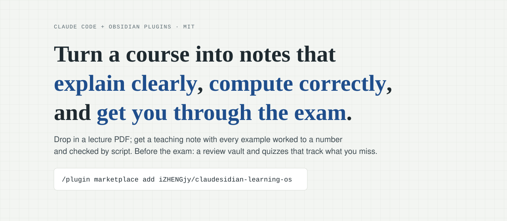
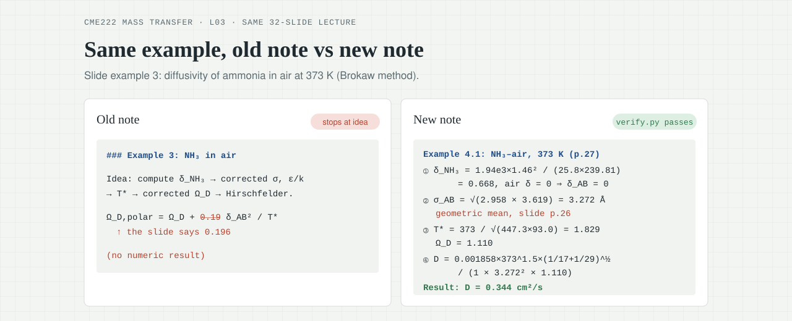
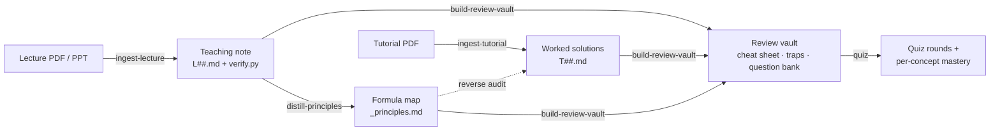

<div align="center">

<a href="https://izhengjy.github.io/claudesidian-learning-os/"></a>

# claudesidian-learning-os

**Claude Code + Obsidian plugins that turn lecture slides into teaching notes you can trust —<br>every example worked to a number, every number re-checked by a script before the note counts as done.**

[](https://github.com/iZHENGjy/claudesidian-learning-os/actions/workflows/ci.yml)
[](CHANGELOG.md)
[](https://claude.com/claude-code)
[](LICENSE)

**English** · [简体中文](README.zh-CN.md)

[Live demo](https://izhengjy.github.io/claudesidian-learning-os/) · [Real course example](examples/CME222-mass-transfer) · [Quickstart](#quickstart) · [Changelog](CHANGELOG.md)

</div>

---

## Why

Ask an LLM to "make notes from these slides" and you get a tidy summary that **stops at "the idea is…"**, copies a coefficient slightly wrong, and links to pages that don't exist. It reads well, so nobody notices — until the exam.

This project treats a study note like code: it has a spec, and it has to **pass checks** before it counts as done.

<p align="center"></p>

<p align="center"><sub>Same slide, same example. Left: a typical AI note. Right: this pipeline — worked to the answer, coefficient checked against the slide, verified by script.</sub></p>

## What you get



| During the term | Before the exam |
|---|---|
| **One teaching note per lecture**<br>• each concept: why you need it → how it works → the slide's definition → worked example → pros & cons<br>• a "say it in your own words" self-check per concept<br>• misconceptions with numeric counterexamples, and a prediction question per part | **One review vault per course**<br>• a one-page formula sheet<br>• every trap in one place<br>• a question bank with folded answers<br>• `quiz` rounds that record which concepts you still miss |

## Why you can trust the output

Every lecture note must pass `check_note.py` before it is done. The checks are scripts, not prompts — the model can't talk its way past them.

| Gate | What is checked | A real bug it caught |
|---|---|---|
| **1 · Numbers** | `verify.py` is actually **run** (not trusted from frontmatter). Every example has its own block, and each result in the note must appear in an `assert`, in the same unit. | A mass flux off by **1000×** (g/mol used as kg/mol). On a trial run, **9 of 10** hand-estimated numbers disagreed with the script. |
| **2 · Source** | Every constant in a numbered formula must be found in the slide text extracted by MinerU. Where the slide prints an answer, `assert_slide()` must match it. | Brokaw coefficient written **0.19** instead of **0.196** — in both the note *and* its verify script, so the asserts alone would have passed. |
| **3 · Coverage** | Every slide page is either cited by a section or explicitly skipped with a reason. | Three "Take Home Message" slides that no section referenced. |
| **4 · Teaching** | Sections open with a concrete problem (not a definition or formula); misconceptions carry counterexample → why → correct statement; prediction questions; ≥ 8 exercises; no dead links; every outside claim is cited or marked *to verify*. | 10 dead links and an "I wonder…" section with no answers, in the old notes. |

The checker itself is tested: [`tests/`](tests) feeds it 48 deliberately broken notes — wrong constants, edited results, deleted examples, attempts to game the checks — and runs on every push in CI.

## Results on a real course

[`examples/CME222-mass-transfer`](examples/CME222-mass-transfer) is a chemical-engineering course (mass transfer) run through the pipeline. Same 32-slide lecture, before vs. after:

| | Before | After |
|---|:---:|:---:|
| Lecture examples worked to a number | 0 / 4 | **4 / 4**, asserted in `verify.py` |
| Formula errors | 1 | **0** |
| Outside data with a source | none | all cited, or marked *to verify* |
| Self-checks | 6 unanswered "I wonder…" | **8** own-words checks, **4** predictions, **10** exercises |
| Dead links | 10 | **0** |
| `check_note.py` | 13 problems | **passes** |

Plus a review vault for the whole course: 5 topics, 50 questions with folded answers, every application answer script-verified, and a mastery dashboard after one quiz round.

## Quickstart

**Requirements:** [Claude Code](https://claude.com/claude-code) · an Obsidian vault (PARA folders; the [claudesidian](https://github.com/heyitsnoah/claudesidian) starter works well) · Python 3.10+ · a free [MinerU](https://mineru.net) API token.

> **Note:** skill prompts are currently written in Chinese. They handle material in any language and the notes come out in the language you work in, but expect Chinese in the skill files and progress reports. English prompts are on the roadmap.

```bash
pip install requests PyMuPDF Pillow python-pptx python-dotenv rich pyyaml
```

Set `MINERU_API_TOKEN` in your environment or in a `.env` file at the vault root. Then, in Claude Code inside your vault:

```text
/plugin marketplace add iZHENGjy/claudesidian-learning-os
/plugin install claudesidian-notes@claudesidian-learning-os
```

Then just talk to it:

| Say | You get |
|---|---|
| *"ingest this lecture"* + a PDF | `01_Projects/<CODE>_<course>/L##_<topic>.md` and its `verify.py` |
| *"solve this tutorial"* | `T##_<topic>.md`, audited against the formula map |
| *"distill CME222"* | `_principles.md` — numbered first-principles formula tree |
| *"build the review vault for CME222"* | `复习库/` — overview, cheat sheet, traps, question bank |
| *"quiz me on CME222"* | 4 zero-hint multiple-choice questions + an optional explain-it-back per round, mastery tracked |

Course names can be in any language.

## What's inside

| Plugin | Layer | Contents |
|---|---|---|
| [`claudesidian-notes`](plugins/claudesidian-notes) | Framework | 6 skills (`ingest-lecture`, `ingest-tutorial`, `distill-principles`, `ingest-paper`, `build-review-vault`, `quiz`), 2 commands (`/distill-all`, `/audit-tutorials`), shared scripts (MinerU extraction, page rendering, `check_note.py`, formula audits) |
| [`paper-review-toolkit`](plugins/paper-review-toolkit) | Framework | Literature reviews: paper markdown → structured sample data → one master spreadsheet |
| [`chemeng-coursework`](plugins/chemeng-coursework) | Domain (reference) | Chemical-engineering homework coach: decision-first problem solving, a tested plotting library (ternary, McCabe–Thiele, psychrometric…), docx polishing |

The framework layer holds **no domain knowledge** — the author has run it unchanged on engineering, economics, computer-science and physics courses. `chemeng-coursework` shows how to add your own field; see [`docs/PLUGIN_SPEC.md`](docs/PLUGIN_SPEC.md).

<details>
<summary><b>Repository layout</b></summary>

```text
.claude-plugin/marketplace.json     plugin marketplace entry
plugins/
├── claudesidian-notes/             framework: course + paper pipeline
│   ├── skills/<skill>/             SKILL.md · assets/ (templates) · references/ (rules, lessons)
│   ├── commands/                   /distill-all, /audit-tutorials
│   └── shared/scripts/             check_note.py, mineru_extract.py, reverse_audit.py, …
├── paper-review-toolkit/           framework: literature-review data extraction
└── chemeng-coursework/             domain plugin (reference implementation)
examples/CME222-mass-transfer/      a real course run through the pipeline
docs/                               live demo site + PLUGIN_SPEC.md
tests/                              pytest suite for check_note.py
```

</details>

<details>
<summary><b>Vault conventions the skills expect</b></summary>

```text
01_Projects/<CODE>_<course name>/
├── index.md          course map, appended week by week
├── manifest.md       declares source PDFs + extraction indexes (skills keep it updated)
├── L01_<topic>.md    lecture teaching notes
├── T01_<topic>.md    tutorial solutions
├── _principles.md    distilled formula map with numbered equations
├── 复习库/            review vault: overview, cheat sheet, traps, question bank, mastery
└── _attachments/     sources + MinerU output + per-lecture verify.py
```

Skills never hard-code file names: each course declares its materials in `manifest.md`.

</details>

## Reproduce the example

```bash
git clone https://github.com/iZHENGjy/claudesidian-learning-os
cd claudesidian-learning-os
python "examples/CME222-mass-transfer/vault/CME222_传质/_attachments/verify.py"
python plugins/claudesidian-notes/shared/scripts/check_note.py \
  "examples/CME222-mass-transfer/vault/CME222_传质/L03_diffusion_coefficient_estimation.md" \
  --vault examples/CME222-mass-transfer/vault                 # after: passes
python plugins/claudesidian-notes/shared/scripts/check_note.py \
  examples/CME222-mass-transfer/before/L03_diffusion_coefficient_estimation.md \
  --vault examples/CME222-mass-transfer/vault --no-run        # before: 13 problems
pip install pytest && pytest -q                               # the checker's own tests
```

## Known limitations

Honest about what the checks cannot see:

- **Citations are checked for consistency, not truth.** A made-up reference that is also listed under References passes; the skill requires an online check, but no script verifies it.
- **Coverage trusts `pages_skipped`.** A page can be skipped to get past the check — so the run report must list every skipped page with its reason, for you to review.
- **Stability across runs is not yet benchmarked.** The checks raise the floor of a single note; a multi-course, repeated-run benchmark is on the roadmap.
- Slides with scanned images or heavy OCR noise make the constant check noisier; confirmed exceptions go in the note's `constants_manual`.

## Roadmap

- [ ] Stability benchmark: 3 subjects × 5 lectures × 2 runs, pass rate and reviewer scores
- [ ] Bilingual (EN/ZH) skill prompts
- [ ] Apply the same number/source gates to `ingest-tutorial`
- [ ] More domain plugins (contributions welcome)

## Contributing

Issues and PRs are welcome — especially new domain plugins and English prompt translations. See [CONTRIBUTING.md](CONTRIBUTING.md).

## Credits

Built on a vault started from [claudesidian](https://github.com/heyitsnoah/claudesidian) by Noah Brier. PDF extraction by [MinerU](https://github.com/opendatalab/MinerU). The teaching-note structure borrows from [Love Learning Anything](https://github.com/RAIZ-Zzz/love-learning-anything) (MIT); the review vault and quiz borrow from [tutor-skills](https://github.com/RoundTable02/tutor-skills) (MIT). The example course's slides are not redistributed.

## License

[MIT](LICENSE)
