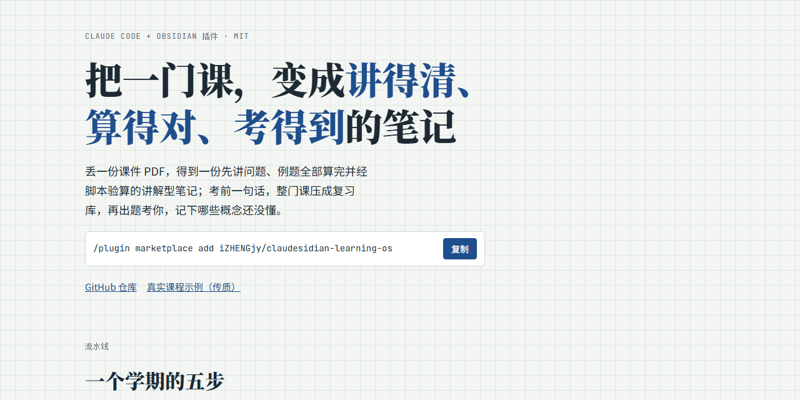
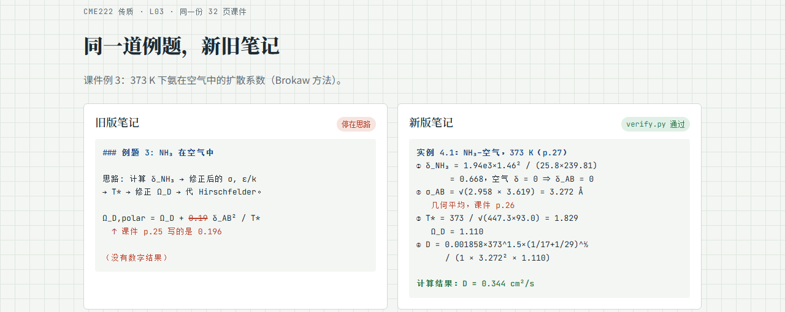
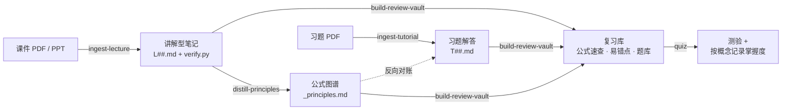

<div align="center">

<a href="https://izhengjy.github.io/claudesidian-learning-os/"></a>

# claudesidian-learning-os

**Claude Code + Obsidian 插件：把课件变成能放心用的讲解型笔记——<br>例题都算到数字，每个数字都由脚本复核。**

[](https://github.com/iZHENGjy/claudesidian-learning-os/actions/workflows/ci.yml)
[](CHANGELOG.md)
[](https://claude.com/claude-code)
[](LICENSE)

[English](README.md) · **简体中文**

[在线展示](https://izhengjy.github.io/claudesidian-learning-os/) · [真实课程示例](examples/CME222-mass-transfer) · [快速上手](#快速上手) · [更新日志](CHANGELOG.md)

</div>

---

## 为什么做这个

让大模型"把这份课件整理成笔记"，通常会得到一份读起来很顺的总结：例题**停在"思路是……"**，某个系数抄错了一位，还链接到根本不存在的页面。因为读着顺，没人发现——直到考试。

这个项目把笔记当代码对待：有规范，而且必须**通过检查**才算完成。

<p align="center"></p>

<p align="center"><sub>同一页课件、同一道例题。左：常见的 AI 笔记。右：本流水线——算到结果，系数对照课件，脚本验算。</sub></p>

## 产出什么



| 学期中 | 考试前 |
|---|---|
| **每讲一份讲解型笔记。** 每个知识点按"为什么需要它 → 怎么工作 → 课件定义 → 实例 → 优缺点 → 用自己的话说"展开；每部分结尾有带数字反例的误区和一道预测题。 | **每门课一个复习库。** 一页公式速查、全部易错点、答案折叠的题库。`quiz` 用零提示题考你，记录哪些概念还没掌握。 |

## 为什么能放心用

每份讲义笔记都必须通过 `check_note.py` 才算完成。检查是脚本，不是提示词——模型没法靠"自述已完成"混过去。

| 关卡 | 检查什么 | 实际抓到过的错 |
|---|---|---|
| **1 · 数字** | 真的**运行** `verify.py`（不信 frontmatter 自报）；每道实例在脚本里有对应段落；笔记里的结果必须出现在 `assert` 里，单位一致 | 质量通量差 **1000 倍**（g/mol 当 kg/mol 用）。试跑时手估的 10 个数有 **9 个**和脚本对不上 |
| **2 · 课件原文** | 带编号公式里的每个常数，都必须能在 MinerU 抽出的课件原文里找到；课件印了答案的，`assert_slide()` 必须对上 | Brokaw 系数 **0.196** 写成 **0.19**——笔记和验算脚本**一起错**，光靠 assert 发现不了 |
| **3 · 覆盖** | 课件每一页，要么被某节引用，要么写明理由跳过 | 3 页 "Take Home Message" 没有任何一节引用 |
| **4 · 教学** | 知识点从具体问题讲起（不以定义或公式开头）；误区有"反例 → 为什么不对 → 正确说法"；有预测题；练习 ≥ 8；无空链接；课件外内容有出处或标"待核实" | 旧笔记有 10 个空链接，还有一段没人回答的"我的疑问" |

检查器本身也被测过：[`tests/`](tests) 用 48 份故意做坏的笔记（改错常数、改结果、删实例、钻检查的空子）测试它，每次推送都在 CI 上跑。

## 真实课程效果

[`examples/CME222-mass-transfer`](examples/CME222-mass-transfer) 是一门真实化工课程（传质）跑完流水线的产出。同一讲 32 页课件，新旧对比：

| | 旧版 | 新版 |
|---|:---:|:---:|
| 课件例题算到结果 | 0 / 4 | **4 / 4**，`verify.py` 断言 |
| 公式错误 | 1 处 | **0** |
| 课件外数据有出处 | 无 | 全部有出处或标"待核实" |
| 自测 | 6 个没人回答的"我的疑问" | **8** 个复述检查、**4** 道预测题、**10** 道练习 |
| 空链接 | 10 | **0** |
| `check_note.py` | 13 处问题 | **通过** |

另有整门课的复习库：5 个主题 50 题、答案折叠、应用题全部脚本验算，以及一轮测验后的掌握度看板。

## 快速上手

**需要：** [Claude Code](https://claude.com/claude-code) · 一个 Obsidian vault（PARA 目录；[claudesidian](https://github.com/heyitsnoah/claudesidian) 起步模板很合适） · Python 3.10+ · 免费的 [MinerU](https://mineru.net) API token。

> **说明：** skill 提示词目前是中文。课件用什么语言都能处理，笔记用你工作的语言输出。

```bash
pip install requests PyMuPDF Pillow python-pptx python-dotenv rich pyyaml
```

把 `MINERU_API_TOKEN` 设为环境变量，或写进 vault 根目录的 `.env`。然后在 vault 里打开 Claude Code：

```text
/plugin marketplace add iZHENGjy/claudesidian-learning-os
/plugin install claudesidian-notes@claudesidian-learning-os
```

之后直接说：

| 你说 | 得到 |
|---|---|
| "整理这节课" + PDF | `01_Projects/<CODE>_<课名>/L##_<主题>.md` 和它的 `verify.py` |
| "解这份 tutorial" | `T##_<主题>.md`，并和公式图谱反向对账 |
| "蒸馏 CME222" | `_principles.md`——带编号的第一原理公式树 |
| "做 CME222 的复习库" | `复习库/`——总览、公式速查、易错点、题库 |
| "考我 CME222" | 每轮 4 道零提示选择题 + 可选 1 道复述题，记录掌握度 |

课名用什么语言都行。

## 包含什么

| 插件 | 层 | 内容 |
|---|---|---|
| [`claudesidian-notes`](plugins/claudesidian-notes) | 框架层 | 6 个 skill（`ingest-lecture`、`ingest-tutorial`、`distill-principles`、`ingest-paper`、`build-review-vault`、`quiz`）、2 个命令（`/distill-all`、`/audit-tutorials`）、共享脚本（MinerU 抽取、逐页渲染、`check_note.py`、公式对账） |
| [`paper-review-toolkit`](plugins/paper-review-toolkit) | 框架层 | 文献综述：论文 markdown → 结构化样本数据 → 一张主表 |
| [`chemeng-coursework`](plugins/chemeng-coursework) | 领域层（参考实现） | 化工作业助手：决策前置解题、经过测试的画图库（三角相图、McCabe–Thiele、湿度图…）、docx 排版 |

框架层**不含任何领域知识**——作者在工科、经济学、计算机、物理课程上都原样跑过。`chemeng-coursework` 演示怎么加自己的领域，见 [`docs/PLUGIN_SPEC.md`](docs/PLUGIN_SPEC.md)。

<details>
<summary><b>仓库结构</b></summary>

```text
.claude-plugin/marketplace.json     插件市场入口
plugins/
├── claudesidian-notes/             框架：课程 + 论文流水线
│   ├── skills/<skill>/             SKILL.md · assets/（模板） · references/（规则、踩坑记录）
│   ├── commands/                   /distill-all、/audit-tutorials
│   └── shared/scripts/             check_note.py、mineru_extract.py、reverse_audit.py …
├── paper-review-toolkit/           框架：文献综述数据抽取
└── chemeng-coursework/             领域插件（参考实现）
examples/CME222-mass-transfer/      一门真实课程跑完流水线的产出
docs/                               在线展示页 + PLUGIN_SPEC.md
tests/                              check_note.py 的 pytest 测试
```

</details>

<details>
<summary><b>skill 预期的 vault 结构</b></summary>

```text
01_Projects/<CODE>_<课名>/
├── index.md          课程地图，按周追加
├── manifest.md       声明源 PDF 和抽取索引（skill 自动更新）
├── L01_<主题>.md     讲解型笔记
├── T01_<主题>.md     习题解答
├── _principles.md    带编号公式的第一原理图谱
├── 复习库/            总览、公式速查、易错点、题库、掌握度
└── _attachments/     原件 + MinerU 输出 + 每讲的 verify.py
```

skill 从不写死文件名：每门课在 `manifest.md` 里声明自己的材料。

</details>

## 自己验证示例

```bash
git clone https://github.com/iZHENGjy/claudesidian-learning-os
cd claudesidian-learning-os
python "examples/CME222-mass-transfer/vault/CME222_传质/_attachments/verify.py"
python plugins/claudesidian-notes/shared/scripts/check_note.py \
  "examples/CME222-mass-transfer/vault/CME222_传质/L03_diffusion_coefficient_estimation.md" \
  --vault examples/CME222-mass-transfer/vault                 # 新版：通过
python plugins/claudesidian-notes/shared/scripts/check_note.py \
  examples/CME222-mass-transfer/before/L03_diffusion_coefficient_estimation.md \
  --vault examples/CME222-mass-transfer/vault --no-run        # 旧版：13 处问题
pip install pytest && pytest -q                               # 检查器自己的测试
```

## 已知局限

检查不到的地方，直说：

- **引用只查一致性，不查真伪。** 编造的文献只要也列进参考文献就能通过；skill 要求上网核对，但没有脚本能验证这一步。
- **覆盖检查信任 `pages_skipped`。** 把页塞进跳过列表就能过检查，所以运行报告必须逐页列出跳过理由，供你审。
- **多次运行的稳定性还没做基准测试。** 现在的检查抬高了单份笔记的下限；跨课程、重复运行的基准在路线图上。
- 扫描版或 OCR 噪声大的课件会让常数核对更吵；确认过的例外写进笔记的 `constants_manual`。

## 路线图

- [ ] 稳定性基准：3 个学科 × 5 讲 × 2 次运行，统计通过率和人工评分
- [ ] 中英双语 skill 提示词
- [ ] 把数字 / 课件原文关卡用到 `ingest-tutorial`
- [ ] 更多领域插件（欢迎贡献）

## 参与贡献

欢迎 issue 和 PR，尤其是新的领域插件和提示词英文翻译。见 [CONTRIBUTING.md](CONTRIBUTING.md)。

## 致谢

源自基于 Noah Brier 的 [claudesidian](https://github.com/heyitsnoah/claudesidian) 搭的 vault。PDF 抽取用 [MinerU](https://github.com/opendatalab/MinerU)。讲解型笔记结构借鉴 [Love Learning Anything](https://github.com/RAIZ-Zzz/love-learning-anything)（MIT），复习库和测验借鉴 [tutor-skills](https://github.com/RoundTable02/tutor-skills)（MIT）。示例课程的课件原图不随仓库分发。

## 许可证

[MIT](LICENSE)
