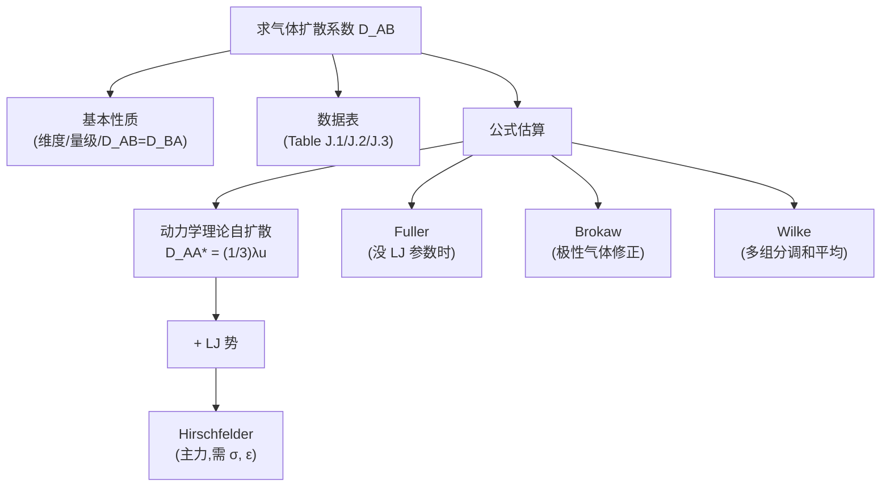

# 分子扩散系数与气体 D 估算 / Molecular Diffusivity & Gas D Estimation

> [!abstract] 本节定位
> - **位置**: 第 3 周, L03 — 把 L02 里那个 "$D$ 哪里来"的问题彻底讲清
> - **前置**: [[L02_diffusive_mass_transfer]](Fick 第一定律 + 总通量公式 — 公式里 D 是参数)
> - **本节核心**: 把 $D$ 的**基本性质**(维度、三态量级、$D_{AB}=D_{BA}$)讲清,然后从**动力学理论**推自扩散公式 → 加 **Lennard-Jones 势**得 **Hirschfelder**(标准) → 缺 LJ 参数用 **Fuller** → 极性气体加 **Brokaw 修正** → 多组分用 **Wilke 调和平均**。形成完整的"何时用哪个公式"**决策树**。
> - **后续**: L04 把 D 估算扩展到液相/固相/多孔介质;再后面所有传质问题都需要先确定 D。

---

## 知识结构



---

## 知识块 1 — 扩散系数 $D$ 的基本性质

### 维度推导

从 Fick 第一定律 $J_{A,z} = -D_{AB} \dfrac{dc_A}{dz}$ 反解 D:

$$
D_{AB} = \frac{-J_{A,z}}{dc_A/dz} = \frac{\text{mol}/(L^2 t)}{(\text{mol}/L^3)/L} = \frac{L^2}{t}
$$

**单位**: $\text{m}^2/\text{s}$ 或 $\text{cm}^2/\text{s}$。

### 三态量级速查(必背)

| 介质 | $D$ 量级(m²/s) | $D$ 量级(cm²/s) | 直觉 |
|---|---|---|---|
| **气体** | $10^{-6} \sim 10^{-5}$ | $10^{-2} \sim 10^{-1}$ | 分子飞快,空隙大 |
| **液体** | $10^{-10} \sim 10^{-9}$ | $10^{-6} \sim 10^{-5}$ | 比气体慢 4-5 个数量级 |
| **固体** | $10^{-14} \sim 10^{-10}$ | $10^{-10} \sim 10^{-6}$ | 比液体再慢 4-5 个数量级 |

**反复验证**: 做完每道题后看一眼数字 — 算出气体 D 是 10⁻¹⁰ m²/s 量级? 大概率单位错了。

### $D$ 受什么影响

- **温度**: 高 T 大(气体 ∝ $T^{1.5\sim1.75}$;液体 ~ 线性;固体 Arrhenius)
- **压力**: 气体 $D \propto 1/P$;液体/固体几乎无关
- **浓度**: 大多数时候弱依赖(稀溶液近似认为 D 常数);浓溶液要用更复杂处理(L04 Leffler-Cullinan)
- **介质性质**: 介质粘度大 → D 小(液体)

### 关键性质: $D_{AB} = D_{BA}$(二元、恒 c、恒 T,P)

证明: 二元理想气体 $c_A + c_B = c = P/RT$ = 常数 → $dc_A/dz = -dc_B/dz$。等摩尔反向扩散下 $J_A = -J_B$ → $-D_{AB}(dc_A/dz) = -(-D_{BA})(dc_B/dz)$ → 代入 $dc_B = -dc_A$ → $D_{AB} = D_{BA}$。

> ⚠️ **这只对气相 + 二元 + 恒 c 成立**。液相不一定:乙醇在水里 ≠ 水在乙醇里(L04 Wilke-Chang 会讨论)。

### 三态数据表 (Welty 附录)

| 表 | 内容 | 单位约定 |
|---|---|---|
| Table **J.1** | 气体二元扩散率(常压、不同温度) | cm²/s × 1 atm 标准化, 也给 m²/s × 10⁵ |
| Table **J.2** | 液相扩散率 | cm²/s × 10⁵, 或 m²/s × 10⁹ |
| Table **J.3** | 固相扩散率 | cm²/s, 或 m²/s × 10⁴ |

**用法**: 题目能查表的优先查表(实验值最准),查不到才用估算公式。

---

## 知识块 2 — 动力学理论:自扩散公式

**自扩散** = 同一物质里 A 和它的同位素 A* 之间扩散(实验上用放射性同位素标记 A 来测)。这是最简单的情况,推导出 D 的"骨架公式"。

### 起点假设(L03 强调的"4 条")

1. **理想气体**(忽略分子势能贡献)
2. **低密度**(分子间空隙 >> 分子大小)
3. **刚性球**(无分子间作用力)
4. **弹性碰撞**(动量+能量守恒)

### 核心公式

$$
\boxed{D_{AA^*} = \frac{1}{3} \lambda u}
$$

其中:

$$
\lambda = \frac{k_B T}{\sqrt{2}\pi \sigma_A^2 P}\quad(\text{平均自由程})
$$

$$
u = \sqrt{\frac{8 k_B N T}{\pi M_A}}\quad(\text{分子平均速率})
$$

代入合并后:

$$
D_{AA^*} = \frac{2 T^{3/2}}{3 \pi^{3/2} \sigma_A^2 P} \left( \frac{k_B^3 N}{M_A} \right)^{1/2}
$$

| 符号 | 含义 | 单位 |
|---|---|---|
| $M_A$ | 分子量 | kg/mol |
| $N$ | 阿伏伽德罗常数 | 6.022 × 10²³ /mol |
| $P$ | 压力 | Pa |
| $T$ | 温度 | K |
| $k_B$ | Boltzmann 常数 | 1.38 × 10⁻²³ J/K |
| $\sigma_A$ | Lennard-Jones 直径(碰撞直径) | m |

### Mean free path 概念图

（vault 中此处为课件截图，示例仓库不附原图）
> 平均自由程 λ:分子从一次碰撞到下一次碰撞之间走的平均直线距离。低密度气体里 λ 远大于分子直径 — 这是动力学理论成立的前提。

### Lennard-Jones (LJ) 势 + 碰撞直径

（vault 中此处为课件截图，示例仓库不附原图）
> 两个球形分子靠近 → 距离很近时强烈排斥(短程势能斥力↑↑) → 距离远时微弱吸引(范德华力)。**碰撞直径 σ** 定义为势能 = 0 的最近距离(LJ 势能曲线零点)。

（vault 中此处为课件截图，示例仓库不附原图）
> Lennard-Jones 6-12 势能曲线: $U(r) = 4\varepsilon[(\sigma/r)^{12} - (\sigma/r)^{6}]$。两个参数:
> - **σ**: 势能 = 0 的距离(碰撞直径)
> - **ε**: 势阱深度(分子间最大吸引能)

---

## 知识块 3 — 二元混合气 + P/T 标度律

A、B 直径不等 → σ 取算术平均、1/M 用 (1/2M_A + 1/2M_B):

$$
D_{AB} = \frac{2}{3}\left(\frac{k_B}{\pi}\right)^{3/2} N^{1/2} T^{3/2} \frac{\left(\dfrac{1}{2M_A}+\dfrac{1}{2M_B}\right)^{1/2}}{P\left(\dfrac{\sigma_A+\sigma_B}{2}\right)^2}
$$

**P/T 标度律**(动力学硬球模型给出):

$$
D_{AB} \propto \frac{1}{P}, \qquad D_{AB} \propto T^{3/2}
$$

→ **温度外推**: 已知 $(T_1, P_1)$ 下 D,可推到 $(T_2, P_2)$:

$$
D_{AB,T_2,P_2} = D_{AB,T_1,P_1} \cdot \frac{P_1}{P_2} \cdot \left(\frac{T_2}{T_1}\right)^{3/2}
$$

> ⚠️ **真实气体的 T 指数其实是 1.5-1.75**,不是固定 1.5。引入 LJ 相互作用后变成 ~1.75(这就是 Fuller 用 $T^{1.75}$ 的原因)。

---

## 知识块 4 — Hirschfelder 方程(气体 D 主力公式)

### 公式

$$
\boxed{D_{AB} = \frac{0.001858 \, T^{3/2} \left( \dfrac{1}{M_A} + \dfrac{1}{M_B} \right)^{1/2}}{P \, \sigma_{AB}^2 \, \Omega_D}}
$$

| 符号 | 含义 | 单位(注意混合 cgs) |
|---|---|---|
| $D_{AB}$ | 二元扩散系数 | **cm²/s** |
| $T$ | 温度 | K |
| $M_A, M_B$ | 分子量 | **g/mol** |
| $P$ | 压力 | **atm** |
| $\sigma_{AB}$ | 二元混合 LJ 直径 | **Å (Ångström)** |
| $\Omega_D$ | 碰撞积分 | 无量纲 |

> ⚠️ **Hirschfelder 是混合 cgs 单位制**:cm²/s + atm + g/mol + Å。**代入前先把所有量换到这套单位**,这是最常见的错误源。SI 单位代进去会差 5 个数量级。

### 混合规则(Mixing Rules)

（vault 中此处为课件截图，示例仓库不附原图）

$$
\sigma_{AB} = \frac{\sigma_A + \sigma_B}{2}\quad(\text{算术平均})
$$

$$
\varepsilon_{AB} = \sqrt{\varepsilon_A \cdot \varepsilon_B}\quad(\text{几何平均})
$$

LJ 参数 σ 和 ε(以 ε/k 形式给)在 Welty 附录或 Reid/Prausnitz 教材里查。

### 碰撞积分 $\Omega_D$

$\Omega_D$ 把分子间引力 + 斥力打包成一个修正因子。它是无量纲温度的函数:

$$
T^* = \frac{k_B T}{\varepsilon_{AB}}
$$

T* 大 → 分子动能远大于势能 → 碰撞接近硬球弹性 → $\Omega_D \to 1$。
T* 小 → 势能起决定作用 → $\Omega_D > 1$(吸引使有效碰撞截面更大)。

（vault 中此处为课件截图，示例仓库不附原图）
> $\Omega_D$ vs $T^* = k_B T/\varepsilon$ 曲线/查表。常温下气体 $T^* \sim 1-3$,$\Omega_D \sim 0.95-1.2$。**升温总让 $\Omega_D$ 变小,所以 D 随 T 增长比 T^1.5 还快一点**(综合 T^1.5 × 1/Ω_D 大致就是 T^1.75)。

### Hirschfelder 温度外推公式

$$
D_{AB,T_2,P_2} = D_{AB,T_1,P_1} \cdot \frac{P_1}{P_2} \cdot \left(\frac{T_2}{T_1}\right)^{3/2} \cdot \frac{\Omega_{D,T_1}}{\Omega_{D,T_2}}
$$

**比纯硬球版多了 $\Omega_D$ 比** — 让 T 外推更准。

---

## 知识块 5 — Fuller 关联式(没 LJ 参数时用)

### 适用条件

**有 M、有原子组成、但没有 σ/ε 数据**(这是工程实践里最常见的情况 — LJ 参数不是任意化合物都能查到)。

### 公式

$$
\boxed{D_{AB} = \frac{10^{-3} \, T^{1.75} \left( \dfrac{1}{M_A} + \dfrac{1}{M_B} \right)^{1/2}}{P \left[ (\Sigma v)_A^{1/3} + (\Sigma v)_B^{1/3} \right]^2}}
$$

| 符号 | 含义 | 单位 |
|---|---|---|
| $D_{AB}$ | | **cm²/s** |
| $T$ | 温度 | K |
| $P$ | 压力 | **atm** |
| $M$ | 分子量 | g/mol |
| $\Sigma v$ | 原子/结构扩散体积之和 | (查表得 cm³/mol) |

**注意 T^1.75 不是 T^1.5**(动力学硬球的指数被半经验修正了)。

### Σv 怎么查

Welty 附录有 **Fuller 原子扩散体积表**(L03 PPT 也给出这一页):

| 简单分子 | Σv | 简单分子 | Σv |
|---|---|---|---|
| H₂ | 7.07 | He | 2.88 |
| N₂ | 17.9 | O₂ | 16.6 |
| Air | 20.1 | CO | 18.9 |
| CO₂ | 26.9 | H₂O | 12.7 |
| NH₃ | 14.9 | SO₂ | 41.1 |

**复杂分子**: 按原子加和(C=16.5, H=1.98, O=5.48, N=5.69, Cl=19.5),芳环 −20.2 修正。

### 例题 1: CO₂ 在空气中

> 求 CO₂ - 空气 在 20 °C, 1 atm 下的 D。

Hirschfelder 算 + Fuller 算两版,跟 Table J.1 查到的实验值(约 0.151 cm²/s)对比验证。两者通常差 < 10%。

---

## 知识块 6 — Brokaw 修正(极性气体)

### 适用条件

**当至少一个组分有显著偶极矩**(NH₃, SO₂, H₂S, H₂O 蒸汽, CH₃OH 蒸汽 等)— Hirschfelder 直接用会偏低,因为没考虑极性吸引。

### 修正思路

把 Hirschfelder 的 $\Omega_D$ 替换成**极性版** $\Omega_{D,\text{polar}}$:

$$
\Omega_{D,\text{polar}} = \Omega_D + \frac{0.19 \, \delta_{AB}^2}{T^*}
$$

其中 $\delta_{AB}$ 是混合极性参数:

$$
\delta_{AB} = \sqrt{\delta_A \delta_B}, \quad \delta_i = \frac{1.94 \times 10^3 \mu_p^2}{V_b T_b}
$$

| 符号 | 含义 |
|---|---|
| $\mu_p$ | 偶极矩(Debye) |
| $V_b$ | 沸点处摩尔体积 (cm³/mol) |
| $T_b$ | 正常沸点 (K) |

LJ 参数也用极性修正版:

$$
\sigma = \left[ \frac{1.585 \, V_b}{1 + 1.3 \, \delta^2} \right]^{1/3}, \quad \frac{\varepsilon}{k_B} = 1.18(1 + 1.3 \delta^2) T_b
$$

### 退化情况

**A 极性 + B 非极性**(如 NH₃ 在空气中):此时 $\delta_B = 0$ → $\delta_{AB} = 0$ → 极性修正项 0 → **退化回 Hirschfelder**。

> [!question] 这真的合理吗?
> 直觉上 A 是极性,即使 B 非极性,A 还是会被极化等的影响吧? 但 Brokaw 模型把"两边都非极性 + 两边都极性"区分,中间情况用纯 Hirschfelder。这是模型简化,精度有限。

### 例题 3: NH₃ 在空气中

> 给 NH₃ 沸点 239.81 K, 偶极矩 1.46 D, 空气沸点 78.8 K(没偶极)等参数。

**思路**: 计算 $\delta_{NH_3}$ → 修正后的 σ, ε/k → $T^* = T/(\varepsilon/k_B)$ → 修正 $\Omega_D$ → 代 Hirschfelder。

---

## 知识块 7 — Wilke 调和平均(多组分)

### 适用条件

**3 种或更多气体的混合**, 求 A 在混合物中的有效扩散系数 $D_{Am}$。

### 公式

$$
\boxed{\frac{1}{D_{Am}} = \sum_{j=2}^{n} \frac{y_j'}{D_{Aj}}}
$$

或等价:

$$
D_{Am} = \frac{1}{\displaystyle\sum_{j=2}^n y_j'/D_{Aj}}
$$

| 符号 | 含义 |
|---|---|
| $D_{Aj}$ | A 与第 j 组分的二元扩散系数 |
| $y_j' = \dfrac{y_j}{1 - y_A}$ | **不计 A** 的相对摩尔分数 |

### 物理直觉(扩散阻力并联)

把每个 j 组分对 A 的"扩散阻力" $1/D_{Aj}$ 看作并联电阻:总电阻 = 各分支电阻按浓度加权的并联。**多组分相当于把 A 在每个其他组分中的扩散"串行加权",这是阻力的串联,不是并联。**

### 例题 4: SiH₄ CVD

> SiH₄ 0.75 mol% + H₂ 1.5 mol% + N₂ 97.75 mol% 在 900 K, 100 Pa 下,求 SiH₄ 在混合气中的有效 D。
>
> 先算 $D_{\text{SiH}_4 - \text{H}_2}, D_{\text{SiH}_4 - \text{N}_2}$ (Hirschfelder),然后:
>
> $y_{H_2}' = 0.015 / (1 - 0.0075) \approx 0.0151$
> $y_{N_2}' = 0.9775 / (1 - 0.0075) \approx 0.985$
>
> $1/D_{Am} = 0.0151/D_{\text{SiH}_4-H_2} + 0.985/D_{\text{SiH}_4-N_2}$

---

## 知识块 8 — 何时用哪个公式?决策树

```
求气体 D_AB
│
├─ 表里能查到? (Table J.1) → 直接查!
│
└─ 估算
    │
    ├─ 多组分(≥3 种气体)? → Wilke 调和平均(基于二元 D)
    │
    ├─ 至少一个极性气体? → Hirschfelder + Brokaw 修正
    │
    ├─ 有 LJ 参数(σ, ε)? → Hirschfelder ⭐ 主力
    │
    └─ 没 LJ 参数,只有原子组成? → Fuller(查 Σv)

已知一个 (T₁, P₁) 下 D, 求 (T₂, P₂):
└─ Hirschfelder 外推式(带 Ω_D 比)
```

---

## 对比与总结

| 公式 | T 指数 | 单位制 | 关键参数 | 适用条件 |
|---|---|---|---|---|
| 自扩散硬球 | 1.5 | SI | σ, M | 同位素自扩散(理论) |
| **Hirschfelder** | 1.5 (×Ω_D 让有效 ~1.75) | cgs 混合 | σ, ε, M | 二元 + 非极性 |
| **Fuller** | 1.75 | cgs 混合 | Σv, M | 二元 + 没 LJ 参数 |
| **Brokaw** | 同 Hirsch | cgs 混合 | σ, ε, μ_p, V_b, T_b | 二元 + 极性 |
| **Wilke** | (内含 Hirsch/Fuller) | (按子公式) | 各二元 D | 多组分 |

**P 标度**: 全部 ∝ 1/P。
**T 标度**: 实测气体 D 大约 ∝ $T^{1.5\sim1.75}$。

---

## 本节引入的核心概念

- [[扩散系数 D]]
- [[平均自由程 mean free path]]
- [[Lennard-Jones 势]]
- [[碰撞直径 σ]]
- [[势阱深度 ε]]
- [[碰撞积分 Ω_D]]
- [[Hirschfelder 方程]]
- [[Fuller 关联式]]
- [[Brokaw 极性修正]]
- [[Wilke 调和平均]]

---

## 我的疑问

> [!question]
> 1. **Hirschfelder 单位制**(cm²/s, atm, Å, g/mol) **vs SI 实操怎么转?** 有没有"先 SI 算然后换"或"先 cgs 然后换"的最稳妥流程?
> 2. **$\Omega_D$ 表/曲线在哪查最方便?** 精度多少? 用 fitting 公式(Neufeld 关联式之类)代替查表会差很多吗?
> 3. **Brokaw 在"A 极性 + B 非极性"时退化成 Hirschfelder** — 这真的合理吗? 物理上 A 的偶极应该对 B 也有诱导效应啊?
> 4. **Wilke 调和平均的物理直觉** — 真的是"扩散阻力并联"吗? 调和平均是阻力**串联**(电阻并联),不是阻力并联吧?要重新厘清这个类比。
> 5. **Fuller 的 Σv 表里**,**苯环修正 −20.2**,这个负值是什么意思? 物理上是"环上原子贡献减小"还是另有含义?
> 6. **同一对气体用 Hirschfelder 和 Fuller 算结果差几% 是正常?** 什么时候必须用更高级模型(Chapman-Enskog 完整版、量子力学)?

---

## 个人补充

> [!note] 我的理解
> (上完课后填:课堂上听到的、想到的)

---

> [!info]- PPT 原文(Slides 1–32)
> **Slides 1–3**: 课程封面 + TOC + Molecular Diffusivity 章节封面
> **Slide 4**: D 维度推导 = L²/t + 三态量级速查
> **Slides 5–8**: Tables J.1 (气体二元), J.2 (液相), J.3 (固相) — 数据表
> **Slide 9**: $D_{AB} = D_{BA}$ 推导(二元 + 恒 c + 等摩尔反向扩散)
> **Slide 10**: 章节封面 "Estimation of Diffusion Coefficient"
> **Slide 11**: 4 条假设(理想气体 + 低密度 + 刚球 + 弹性碰撞)
> **Slides 12–14**: 自扩散公式 $D_{AA^*} = (1/3)\lambda u$ + λ + u 展开 + 合并形式
> **Slide 15**: Lennard-Jones 6-12 势能曲线 + 碰撞直径 σ + 势阱 ε
> **Slides 16–17**: 二元 D_AB(σ_AB, M_A,M_B 算术平均) + P/T 标度律
> **Slide 18**: Hirschfelder 公式 + 混合规则 σ_AB = (σ_A+σ_B)/2, ε_AB = √(ε_A ε_B)
> **Slide 19**: 碰撞积分 $\Omega_D$ = f(T*) 曲线/表
> **Slide 20**: Hirschfelder 温度外推公式
> **Slide 21**: Example 1 (CO₂ in air, 20 °C, 1 atm)
> **Slides 22–23**: Fuller 公式 + 原子扩散体积表(常见分子 + 元素加和)
> **Slide 24**: Example 2 (Benzene-Air, Fuller 法)
> **Slides 25–26**: Brokaw 公式(极性气体修正) + Ω_D 8 个常数关联表
> **Slide 27**: Example 3 (NH₃ in air, NH₃ 偶极矩 1.46 D) + 摩尔体积 Table 24.4
> **Slide 28**: Wilke 多组分公式 $1/D_{Am} = \Sigma y_j'/D_{Aj}$
> **Slide 29**: Example 4 (SiH₄ in H₂/N₂ 混合, 900 K, 100 Pa)
> **Slides 30–32**: Take Home Message — Self-D / Binary D / Hirschfelder / Fuller / Brokaw / Wilke 一页速查
