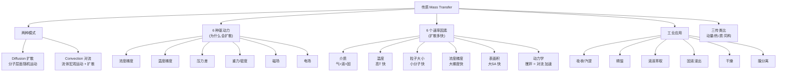

# 传质导论 / Introduction to Mass Transfer

> [!abstract] 本节定位
> - **位置**: 第 1 周, L01 — 整门课的大纲铺垫
> - **前置**: 大一物理(运动、力)、大一化学(浓度、混合物)、流体力学(对流、流体静力学)
> - **本节核心**: 把"传质"这个抽象概念**讲到能用一个词解释**: 任何"组分从一个地方搬到另一个地方"的过程都是传质;它由两种基本模式(扩散 + 对流)组成,扩散又由 6 种"驱动力"驱动,而扩散速率受 6 个因素影响。最后用**三传类比**把整门课的数学框架立起来。
> - **后续**: L02 把扩散数学化(Fick 定律) → L03/L04 把扩散系数 D 算清楚 → 再讲对流传质 / 相间传质 / 工业单元(吸收、精馏、萃取、干燥、膜)。

---

## 知识结构



---

## 知识块 1 — 什么是传质?(定义 + 直觉)

### 一句话定义

**传质 = 一种或多种化学组分在流体混合物里"挪窝"的过程**(transports of one or more chemical species in a fluid mixture)。

注意几个关键点:
- **是组分的搬运,不是流体整体的搬运** — 河水流动是流体力学,但里面的染料从一岸扩散到对岸**才是**传质。
- **以浓度差为底色,但不是只能由浓度差驱动** — 温度差、压力差、磁场、电场都能让物质跑(下面知识块 2)。
- **多组分是前提** — 单一纯物质里没"传质",只能讨论流动。

### 自然趋势(natural tendency)

把一滴墨水滴进水里 — 它会**自发**散开,不需要外力。这就是传质的最朴素例子: **浓度梯度自发推动物质从高浓度区向低浓度区移动,直到均匀(平衡)**。

（vault 中此处为课件截图，示例仓库不附原图）
> 染料从滴入 → 半混 → 完全均匀,三阶段直观演示"浓度梯度驱动的扩散"过程。本图是后面 Fick 第一定律 $J = -D \nabla c$ 的视觉锚点。

（vault 中此处为课件截图，示例仓库不附原图）
> 上图: A 组分浓度沿 x 方向递减(红线),B 沿 x 方向递增(灰线),交点为某个特征位置 x_∞;下图: 容器最初 A、B 分布不均 → 扩散到平衡后均匀。**学这门课时反复回看这张图**:扩散问题本质就是这两条曲线随时间变平的故事。

---

## 知识块 2 — 六种驱动力(为什么会扩散)

PPT 强调驱动力**不止浓度差**,而是"任何化学势差异"。常见 6 种:

### (1) 浓度梯度 — 最常见

高浓度区 → 低浓度区。日常例子:墨水散开、香水扩散、咖啡里加糖等待溶解。**这是后面整门课的主线**。

### (2) 温度梯度 — 热扩散(Thermal Diffusion / Soret Effect)

冷热区域之间,**轻的组分往热端跑、重的往冷端跑**(在二元混合物里大致如此)。

（vault 中此处为课件截图，示例仓库不附原图）
> 双同心管热扩散塔:外管冷壁 + 内管热壁,UF₆ 进料 → 重同位素 U-238 沉到底部 → 顶部富集 U-235。这是早期(1940-50s)分离铀同位素的方法之一。**驱动力是温度差,不是浓度差。**

### (3) 压力差 — 压力驱动膜分离

高压侧的分子会"挤"过半透膜到低压侧。反渗透海水淡化、超滤、纳滤都基于这个。

（vault 中此处为课件截图，示例仓库不附原图）
> 红色小分子能穿过膜,蓝色大分子被挡住 — 压力差是驱动力,膜的孔径决定选择性。

### (4) 重力 / 密度差

密度大的下沉,密度小的上浮。例子:**分液漏斗**(煤油浮在水上 → 放出底层水)、**离心分离**(快速旋转放大重力效应)。这其实也是浓度梯度的特殊形式(沿重力方向)。

### (5) 磁场 — 仅对带磁性 / 离子 / 同位素有效

带电粒子 / 同位素在磁场中按质量偏转不同程度,可分离。例子: **calutron**(电磁同位素分离器,曼哈顿计划用过)。

### (6) 电场 — 仅对带电粒子(离子)有效

正离子被推向负极,负离子被推向正极。例子: **氯碱工业电解槽**(NaCl 水溶液电解 → Cl₂ + H₂ + NaOH)。

（vault 中此处为课件截图，示例仓库不附原图）
> 经典氯碱电解槽:阳极(A) Cl⁻ 失电子 → Cl₂↑;阴极(C) H₂O 得电子 → H₂↑ + OH⁻;中间选择性膜让 Na⁺ 通过到阴极室成 NaOH。**电场是驱动力,膜负责选择性。**

> [!tip] 延伸(非 PPT 内容)
> 这 6 种驱动力其实都可以用**化学势 μ 的梯度**统一: $\nabla \mu = \nabla \mu^{ideal} + \nabla(其他贡献)$,其中"其他贡献"包括温度、压力、电场势能、磁势能等。Stefan-Maxwell / 不可逆热力学 这一套在更高级的传质课里讲。

---

## 知识块 3 — 两种基本模式:扩散 vs 对流

PPT 把传质的"实现机制"分成两大类。**所有传质问题都是这两种的组合**:

（vault 中此处为课件截图，示例仓库不附原图）

### Diffusion(扩散)

- **本质**: 分子层面的**随机运动**(布朗运动) — 分子无规则地撞来撞去,统计平均下来净流量从高浓度区流向低浓度区。
- **载体**: 即使流体宏观静止,扩散也在发生(只要有浓度差)。
- **速率特征**: **慢**。空气中扩散需要小时量级,液体中需要小时-天,固体中需要几年。
- **数学**: Fick 第一定律 $J = -D \nabla c$ (L02 详讲)。

### Convection(对流)

- **本质**: 流体的**宏观整体运动**带着组分一起搬运。
- **特征**: 必有流体在动 — 有的是受迫(forced,如搅拌、泵)、有的是自然(natural,如温差导致密度差形成自然对流)。
- **速率**: 比扩散**快几个量级**(因为整团流体在动)。
- **关系**: **对流不能完全脱离扩散** — 流体动起来后,组分**最终**还是要靠扩散从流体内部跑到界面。所以工程实践里"传质 = 主体对流 + 边界层扩散"是基本模型。

### 一图懂"扩散 vs 对流"

（vault 中此处为课件截图，示例仓库不附原图）
> 同样一杯水加糖块:不搅拌 = 纯扩散(慢),用勺搅 = 对流为主(快很多)。这张图概括了整门课最重要的二分: **静止流体 → diffusion 主导;运动流体 → convection 主导**。

> [!tip] 延伸(非 PPT 内容)
> 严格说,即使在搅拌的体系里,搅拌只能让流体**整体均匀**;最后糖分子要跨过水分子之间的分子尺度间隙,**还是靠扩散**。所以工程上常用 **传质系数 k**(后面对流传质章节)来包装这两步,它内含扩散 + 对流的合成效应。

---

## 知识块 4 — 扩散速率受 6 个因素影响

对单纯扩散问题,影响速率的因素 PPT 列了 6 个:

### (1) 介质(状态):气 > 液 > 固

```
气体扩散系数 D ~ 10⁻⁵ m²/s    (最快,分子间空隙大)
液体扩散系数 D ~ 10⁻⁹ m²/s    (慢 4 个数量级)
固体扩散系数 D ~ 10⁻¹⁴ m²/s   (再慢 5 个数量级)
```

（vault 中此处为课件截图，示例仓库不附原图）
（vault 中此处为课件截图，示例仓库不附原图）
（vault 中此处为课件截图，示例仓库不附原图）
> 三态分子排布:固体紧密堆积 + 不流动、液体松散接触 + 流动、气体稀疏 + 自由飞。**直觉**:介质越疏松,分子越好挪 → D 越大。**记住量级 — 这个差别贯穿整门课。**

### (2) 温度: 高 T 快

T 越高,分子动能越大,跳跃 / 振动 / 自由飞行越快。后面 L03/L04 会精确给出:
- 气体 D ∝ T^(1.5~1.75)
- 液体 D 大致 ∝ T(线性,但其实通过 μ 反比 + Stokes-Einstein 叠加更复杂)
- 固体 D ∝ exp(−Q/RT) — 温度强敏感(Arrhenius)

（vault 中此处为课件截图，示例仓库不附原图）
> 温度高 → 分子运动更剧烈 → 扩散更快。

### (3) 粒子大小: 小分子快

大分子比小分子动得慢(质量大、惯性大、与溶剂碰撞次数多)。**Mw 小一个数量级,D 大致大 √10 ≈ 3 倍**(气体)或更显著(液体大分子比如蛋白质 D 比小分子小 3-4 个数量级)。

（vault 中此处为课件截图，示例仓库不附原图）
> **CO₂ (44 Da) vs 一种蛋白质 (~3,000,000 Da)** 的分子尺寸对比 — Mw 差 5 个数量级,扩散性能差距巨大。

实验证据:在培养皿里同时滴 3 种染料,Mw 越小扩散圈越大:

（vault 中此处为课件截图，示例仓库不附原图）
> 高锰酸钾 KMnO₄ (Mw=158, 橙色)的扩散圈最大,Methylene Blue (Mw=320) 次之,Safranin (Mw=350) 最小。一目了然。

### (4) 浓度梯度: 大梯度快

这就是 Fick 第一定律 $J \propto dc/dx$ 的内容。

（vault 中此处为课件截图，示例仓库不附原图）
> 膜两侧浓度差越大(如 18 vs 4 比 10 vs 4),通量越大,箭头越粗。

### (5) 表面积: 大 SA 快

通量 $J$ 是单位面积速率,所以总传质量 $W = J \cdot A$。**接触面积越大总速率越大**。直觉: 把茶包散开比卷成一团泡得快。

### (6) 动力学(Dynamics): 静止 vs 搅拌

如知识块 3 所述,搅拌引入**对流**,大幅加快传质。这其实跨越了"扩散"边界进入"对流",但 PPT 把它列在扩散影响因素里 — 因为搅拌会**把界面处的浓度梯度刷新**,从而让扩散持续高效。

---

## 知识块 5 — 工业应用场景(为什么要学这门课)

化工分离单元几乎全是传质操作。本讲过了一遍 6 种典型设备:

### 气体吸收 + 汽提(Absorption + Stripping)

- **吸收**: 气相某组分溶解到液相 — 例: 工业排放气中 CO₂ 用胺溶液吸收(碳捕集);天然气脱酸气(脱 H₂S、CO₂)。
- **汽提**: 反过来 — 把液相中溶解的气体逼出 — 例: 水里溶的氨用空气汽提。
- **关键传质方向**: 气液界面。

（vault 中此处为课件截图，示例仓库不附原图）
> 经典 amine CO₂ capture 流程:左侧吸收塔(Absorber)用 Lean Amine 溶液把烟道气里的 CO₂ 吸下来;富 CO₂ 溶液(Rich Amine)送到右侧汽提塔(Stripper),加热让 CO₂ 跑出来 + 溶液再生。EFB 项目里也会涉及类似的吸收/汽提工艺。

### 精馏(Distillation)

- 利用组分**沸点差异**分离,液相加热 → 轻组分先气化 → 顶部得馏分(distillate),重组分留底部(bottom)。
- **每一块塔板上都同时发生气液传质**(轻组分从液相到气相、重组分从气相到液相)。

（vault 中此处为课件截图，示例仓库不附原图）
> 精馏塔结构:中部进料(feed),顶部冷凝器(condenser)出馏分,底部再沸器(reboiler)产气化蒸汽,液相从上往下流(reflux + 进料),气相从下往上(boilup)。**逆流接触最大化传质效率**。

### 液液萃取(Liquid-Liquid Extraction, LLE)

- **基于相对溶解度** — 想分离的组分对萃取剂(solvent)亲和力远大于原溶剂。
- 例:发酵肉汤里**青霉素**用乙酸戊酯萃取;**醋酸**从稀水溶液里用乙醚萃取。

（vault 中此处为课件截图，示例仓库不附原图）
> 逆流萃取流程: feed 与 solvent 反向流动,raffinate(残液)从 feed 端出,extract(萃取液)从 solvent 端出。**逆流总比并流效率高**(后者下游 driving force 早就消耗掉了)。

### 固液浸出(Solid-Liquid Extraction / Leaching)

- 从固体里"泡出"想要的组分。例: 咖啡豆 → 咖啡(用热水浸);植物种子 → 油(用己烷浸);金矿 → 金(用 NaCN 氰化浸出)。
- 受**固体内扩散**(慢)主导 — 这就是为什么咖啡冲煮要时间。

### 干燥(Drying)

- 把固体里的水(或其他液体)蒸到气相中。
- 涉及**固体内液体扩散** + **液体气化** + **气相对流**三步。
- 例:衣物晾晒、食品脱水(冻干、喷雾干燥)、滚筒干燥、闪蒸干燥。

### 膜分离(Membrane Separation)

- 利用半透膜的**选择透过性** — 想要的组分透膜(permeate),其他被截留(retentate)。
- 类型: 反渗透(海水淡化)、纳滤、超滤、微滤、气体分离膜。

（vault 中此处为课件截图，示例仓库不附原图）
> 进料 → 膜 → 渗透物(透过的)+ 截留物(挡住的)。膜的"选择性"由孔径 / 化学亲和力决定。

---

## 知识块 6 — 三传类比(Transport Phenomena Analogies)— 整门课的数学框架

化工核心三大传输现象:

| | 传输的是 | 驱动力 | 速率定律 | 系数 |
|---|---|---|---|---|
| **动量传递** | 动量 | 速度梯度 du/dy | $\tau = -\mu \dfrac{du}{dy}$ (Newton 黏性定律) | μ 黏度 |
| **热量传递** | 热(能) | 温度梯度 dT/dx | $q = -k \dfrac{dT}{dx}$ (Fourier 导热定律) | k 导热系数 |
| **质量传递** | 物质 | 浓度梯度 dc_A/dx | $J_A = -D_{AB} \dfrac{dc_A}{dx}$ (Fick 第一定律) | D_AB 扩散系数 |

### 关键观察

**三个公式形式完全相同**: 通量 = −系数 × 梯度。这就是三传类比 — 一个研究透了,另两个的数学方法**完全可移植**。

- 学过流体力学求 τ 的边界层方程 → 可以**结构上一一对应**地求 J 的扩散方程
- 学过热传里的对流换热系数 h → 直接对应到对流传质系数 k_x
- 学过 Pr / Re 准数 → 对应 Sc / Re,组合成 Sh 数(Sherwood = 传质里的 Nu)

### 直观记忆

- **τ**(剪切应力) 在动量传递里有**两面**: 既是"剪切应力",也是"动量通量"(动量穿过单位面积的速率)。**这两个说法等价** — 因为牛顿第二定律说 力 = 动量变化率。
- **q** = 热通量,**J** = 摩尔通量,**n** 或 **j** = 质量通量(L02 会区分)。

> [!tip] 延伸(非 PPT 内容)
> 准数(dimensionless number)是三传类比最终落地的形式:
> - **动量**: Re(惯性/黏性), Pr(动量扩散/热扩散)
> - **热**: Nu(对流换热/导热)
> - **传质**: Sc(动量扩散/质扩散), Sh(对流传质/扩散)
>
> 关键关联式 $Sh = f(Re, Sc)$ 在数学上和 $Nu = f(Re, Pr)$ 是同构的(后面对流传质章节会重点用)。

---

## 课程行政速查

（示例仓库已删去课程行政信息）

---

## 本节引入的核心概念

<!-- seed-concept skill populates this list automatically. -->

- [[传质 mass transfer]]
- [[扩散 diffusion]]
- [[对流 convection]]
- [[Fick 第一定律]]
- [[扩散系数 D_AB]]
- [[三传类比]]
- [[气体吸收]]
- [[精馏]]
- [[液液萃取]]
- [[膜分离]]

---

## 我的疑问

> [!question]
> 1. **扩散系数 $D$ 在气/液/固三态里差 4–5 个数量级**,怎么形成直觉? 是不是和介质里"分子有效自由路径长度"直接挂钩?
> 2. **Fick 第一定律里 $C$ 用的是什么?** 是质量浓度、摩尔浓度、还是摩尔分数? $D$ 单位会不会因 C 选择不同而变化?(L02 应该会回答)
> 3. **三传类比中 $\tau$ 既是剪切应力又是动量通量** — 这两种说法等价的物理图景是什么? 单位上能验证吗(剪切应力 N/m² vs 动量通量 (kg·m/s)/(m²·s) 是不是等量)?
> 4. **多组分里(>2 种气体)还能用 Fick 吗?** 老师有提"多组分用 D_AM",但 D_AM 怎么从二元 D_AB 们算? 和 Stefan-Maxwell 关系?
> 5. **6 种驱动力之间会不会同时存在?** 比如蒸馏塔里既有温度梯度又有浓度梯度,谁主导? 怎么判断哪个驱动力的贡献更大?
> 6. 课程开头老师说"不止学公式,要学物理直觉" — 但传质很多式子都是经验关联式(后面会看到),物理直觉怎么和经验式协调?

---

## 个人补充

> [!note] 我的理解
> (上完课后填:课堂上听到的、想到的、和其他课联系起来的内容)

---

> [!info]- PPT 原文(Slides 1–53)
> **Slides 1–11 (课程行政)**: 课程封面 / Moodle 注册 / CLO-PLO / 学分 + 评分 + 通过条件 / 课程内容 1-2 / 参考书(Welty 主) / Welty 教材封面 / 答疑时间(周二)
> **Slides 12–13 (TOC + 章节封面)**: 本节内容: Basic Concept of Mass Transfer / Momentum-Energy-Mass Analogies + Basic Concepts of Mass Transfer 章节标题
> **Slides 14–16 (传输现象 + 定义)**: Transport Phenomena 三分支 / 蒸馏塔三传同时发生 / 传质定义 + 6 种驱动力概述
> **Slides 17–24 (六种驱动力详解 + 例子)**: 浓度(蒸发 + 染料扩散) / 温度(铀同位素热扩散塔) / 压力(膜过滤) / 重力(分液漏斗 + 离心) / 磁场(同位素分离 calutron) / 电场(原理 + 氯碱电解) / 更多日常例子(香水/晾衣/烟囱)
> **Slides 25–26 (扩散 vs 对流引入)**: Mode of Mass Transfer 二分树 / Diffusion 定义(分子层面随机运动)
> **Slides 27–38 (扩散影响因素 6 个)**: 浓度剖面图 → 平衡演化 / A-B 双盒 + 染料-膜 6 步演化 / 思考问题占位 / 三态分子排布对比 / 介质量级(气>液>固)/ 温度 / 粒子大小(推箱卡通 + Mw 比较) / 培养皿染料 + Mw 表 / 浓度梯度高低对比 / 表面积 A-B 烧杯 / 搅拌 = diffusion vs convection
> **Slides 39–40 (对流定义 + 应用)**: Convection 4 条要点 + 自然对流图 / 风干衣物 + 河流污染
> **Slides 41–49 (工业应用 9 页)**: 章节封面 / Gas absorption + Stripping / Absorber-Stripper 流程图(amine CO₂ capture) / 精馏塔结构图 / 液液萃取定义 / LLE 并流 vs 逆流框图 / 固液浸出(咖啡/油/金) / 干燥(滚筒 + 闪蒸照片) / 膜分离(Feed/Permeate/Retentate)
> **Slides 50–53 (三传类比 + 行政尾)**: Analogies 章节封面 / 三传对比表(Mass/Heat/Momentum + Fick/Fourier/Newton) / 三个公式 j = -D dc/dx, q = -k dT/dx, τ = -μ du/dy / 调课表(Replacement Classes)
