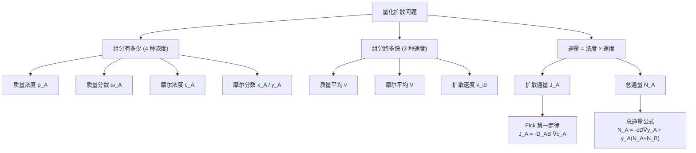

# 扩散传质:浓度、速度、通量与 Fick 第一定律 / Diffusive Mass Transfer

> [!abstract] 本节定位
> - **位置**: 第 2 周, L02 — 把 L01 里"Fick 定律雏形"具体化
> - **前置**: [[L01_intro_to_mass_transfer]](知道扩散是浓度梯度驱动 + 三传类比)
> - **本节核心**: 把"组分有多少"和"组分跑多快"两套语言学清楚 — **4 种浓度** + **3 种速度** + **2 种通量**(质量基/摩尔基),正式给出 Fick 第一定律的 **4 种等价形式**,最后推出整门课最重要的式子: **总通量 $N_A = -cD\nabla y_A + y_A(N_A + N_B)$**(扩散贡献 + 对流贡献)。
> - **后续**: L03/L04 算 D;后续讨论稳态扩散(等摩尔反向、单向)、瞬态扩散(Fick 第二定律)、对流传质都以这个总通量为起点。

---

## 知识结构

---

## 知识块 1 — 组分有多少:4 种浓度表示

混合物里组分 A 的"多少"可以用 4 种语言表达,**任意两种之间都能互换**。先建立这套术语。

### 质量基(mass basis)

| 量 | 定义 | 单位 |
|---|---|---|
| **质量浓度** $\rho_A$ | $\rho_A = \dfrac{m_A}{V}$(每单位体积里 A 的质量) | kg/m³ |
| **总质量浓度(密度)** $\rho$ | $\rho = \displaystyle\sum_{i=1}^n \rho_i$ | kg/m³ |
| **比体积** $\upsilon$ | $\upsilon = \dfrac{V}{m} = \dfrac{1}{\rho}$ | m³/kg |
| **质量分数** $\omega_A$ | $\omega_A = \dfrac{m_A}{m} = \dfrac{\rho_A}{\rho}$ | 无量纲(0–1) |

**关键关系**: $\displaystyle\sum_{i=1}^n \omega_i = 1$。

### 摩尔基(molar basis)

| 量 | 定义 | 单位 |
|---|---|---|
| **摩尔浓度** $c_A$ | $c_A = \dfrac{n_A}{V} = \dfrac{\rho_A}{M_A}$ | mol/m³ |
| **气相理想气体形式** | $c_A = \dfrac{P_A}{RT}$(P_A 是分压) | mol/m³ |
| **总摩尔浓度** $c$ | $c = \displaystyle\sum c_i$ | mol/m³ |
| **摩尔分数(液/固)** $x_A$ | $x_A = \dfrac{n_A}{n} = \dfrac{c_A}{c}$ | 无量纲 |
| **摩尔分数(气)** $y_A$ | $y_A = \dfrac{n_A}{n} = \dfrac{c_A}{c} = \dfrac{P_A}{P}$ | 无量纲 |

**关键关系**: $\displaystyle\sum x_i = 1$ 或 $\displaystyle\sum y_i = 1$;**液/固用 x_A,气用 y_A** — 这是符号习惯。

### 质量分数 ↔ 摩尔分数 互换

最常用的两个换算公式:

$$
x_A = \frac{\omega_A / M_A}{\omega_A/M_A + \omega_B/M_B}
$$

$$
\omega_A = \frac{x_A M_A}{x_A M_A + x_B M_B}
$$

> ⚠️ **二元体系**才长这样。多组分推广:分母换成 $\sum w_i/M_i$ 或 $\sum x_i M_i$。

（vault 中此处为课件截图，示例仓库不附原图）
> 多组分混合物示意:某种 species A(实心黑点)被其他组分(空心圆/三角)包围。每种组分都有自己的浓度,加起来等于总浓度。

---

## 知识块 2 — Example 1:空气组成换算

> 已知空气近似 $y_{O_2} = 0.21, y_{N_2} = 0.79$,$M_{O_2} = 0.032$ kg/mol, $M_{N_2} = 0.028$ kg/mol,25 °C, 101300 Pa。求:
> (i) 平均分子量
> (ii) 各组分质量分数
> (iii) 各组分摩尔浓度

**思路**:
1. **平均 M**: $\bar{M} = y_{O_2} M_{O_2} + y_{N_2} M_{N_2} = 0.21 \times 32 + 0.79 \times 28 \approx 28.84$ g/mol
2. **质量分数**: $\omega_A = x_A M_A / \bar{M}$ → $\omega_{O_2} \approx 0.233, \omega_{N_2} \approx 0.767$
3. **摩尔浓度**: $c = P/(RT) = 101300/(8.314 \times 298.15) \approx 40.87$ mol/m³,然后 $c_{O_2} = y_{O_2} c \approx 8.58, c_{N_2} \approx 32.29$ mol/m³

**做完这道题就掌握了"4 种浓度任意互换"。**

---

## 知识块 3 — 组分跑多快:3 种速度

多组分体系里,**每种组分有自己的实际速度** $v_i$。但讨论"整团"流动时,需要某种**平均速度**。L02 给出三种:

### 1. 质量平均速度 v(mass-average velocity)

按**质量加权**:

$$
\boxed{\mathbf{v} = \frac{\sum_{i=1}^n \rho_i \mathbf{v}_i}{\sum_{i=1}^n \rho_i} = \frac{\sum \rho_i \mathbf{v}_i}{\rho} = \sum \omega_i \mathbf{v}_i}
$$

**物理意义**: 这就是**流体力学里的"流速"** — Navier-Stokes 方程里的 v。

### 2. 摩尔平均速度 V(molar-average velocity)

按**摩尔加权**:

$$
\boxed{\mathbf{V} = \frac{\sum c_i \mathbf{v}_i}{\sum c_i} = \frac{\sum c_i \mathbf{v}_i}{c} = \sum x_i \mathbf{v}_i}
$$

**物理意义**: 摩尔基传质里用得多 — 后面 N_A 公式就基于 V。

> ⚠️ **大写 V 与小写 v 千万别混!**
> - 小写 v = 质量平均速度(整团流体)
> - 大写 V = 摩尔平均速度(整团摩尔)
> - 一般 v ≠ V(分子量不同的组分加权权重不同)
> - **只有当所有组分 M 相同时 v = V**(实际很罕见)

### 3. 扩散速度 v_id(diffusion velocity)

某组分 i **相对于平均速度的差值**:

$$
v_{id} = v_i - \mathbf{v}\ (\text{相对质量平均})
$$

$$
V_{id} = v_i - \mathbf{V}\ (\text{相对摩尔平均})
$$

**物理意义**: 扩散速度 = 分子层面的随机运动**净结果**。**这是后面 J_A 通量的速度版本。**

（vault 中此处为课件截图，示例仓库不附原图）
> 速度分解示意: 静止观察者看 A 组分的速度 $v_A$ = 体相平均速度 V + 扩散速度 $V_{Ad}$。**扩散速度是相对运动流体测量的,不是相对静止观察者**。

---

## 知识块 4 — Example 2:多组分气体的速度计算

> 管道(直径 25 mm)内 4 atm 流的气体混合物: 65% NH₃, 8% N₂, 24% H₂, 3% Ar(摩尔分数)。各组分速度 $v_{NH_3} = v_{N_2} = 0.030$ m/s, $v_{H_2} = 0.035$, $v_{Ar} = 0.020$ m/s。求摩尔平均、质量平均速度,以及 H₂ 的质量扩散速度。

**思路**:
1. **摩尔平均**: $V = \sum x_i v_i = 0.65 \times 0.030 + 0.08 \times 0.030 + 0.24 \times 0.035 + 0.03 \times 0.020 \approx 0.0309$ m/s
2. **质量平均**: 先用 $w_i = x_i M_i / \bar{M}$ 把摩尔分数转成质量分数,$\bar{M} = \sum x_i M_i$,然后 $v = \sum \omega_i v_i$。先算 $\bar{M}$:
   - NH₃ M=17, N₂ M=28, H₂ M=2, Ar M=40
   - $\bar{M} = 0.65 \times 17 + 0.08 \times 28 + 0.24 \times 2 + 0.03 \times 40 \approx 14.97$ g/mol
   - 再算 $\omega_i$,然后 $v$。
3. **H₂ 的质量扩散速度**: $v_{H_2,d} = v_{H_2} - v$(用 v 不是 V,因为问的是质量基扩散速度)

> ⚠️ 题目要的是**质量**扩散速度(用 v_id = v_i − v),不是**摩尔**扩散速度(V_id = v_i − V)。

---

## 知识块 5 — Fick 第一定律:从历史定义出发

**1855 年 Adolf Fick** 把扩散数学化。本质论断: **扩散通量 ∝ 浓度梯度**。

### 矢量形式(最一般)

$$
\boxed{\mathbf{J}_A = -D_{AB} \nabla c_A}
$$

### 一维 z 方向(最常用)

$$
J_{A,z} = -D_{AB} \frac{dc_A}{dz}
$$

| 符号 | 含义 | 单位 |
|---|---|---|
| $J_{A,z}$ | A 组分的**摩尔扩散通量**(z 方向) | mol/(m²·s) |
| $D_{AB}$ | 扩散系数 | m²/s |
| $dc_A/dz$ | 浓度梯度 | (mol/m³)/m |

### 关键限制

1. **等温等压**(isothermal, isobaric)
2. **二元混合物**(binary)
3. **测量参考系是"运动着的流体"**(后面会展开 — 这就是 J_A 和 N_A 区别的根)

---

## 知识块 6 — Fick 第一定律的 4 种等价形式

光给摩尔通量 + 摩尔浓度梯度不够 — 工程实践里有时拿到的是质量浓度、有时是摩尔分数。所以 Fick 实际上有 **4 种"通量 - 梯度"组合**,**全是等价的同一个定律**:

| # | 通量(基础) | 梯度 | 公式 | 何时用 |
|---|---|---|---|---|
| 1 | **摩尔** $J_{A,z}$ | $dc_A/dz$ | $J_{A,z} = -D_{AB} \dfrac{dc_A}{dz}$ | c 直接给 |
| 2 | **摩尔** $J_{A,z}$ | $dy_A/dz$ | $J_{A,z} = -c D_{AB} \dfrac{dy_A}{dz}$ | 气体(给 P/T,c 常数) |
| 3 | **质量** $j_{A,z}$ | $d\rho_A/dz$ | $j_{A,z} = -D_{AB} \dfrac{d\rho_A}{dz}$ | 质量浓度直接给 |
| 4 | **质量** $j_{A,z}$ | $d\omega_A/dz$ | $j_{A,z} = -\rho D_{AB} \dfrac{d\omega_A}{dz}$ | 总密度 ρ 常数 + 质量分数 |

**记忆**: 写 $c_A$ 用就 $D$,写 $y_A$ 多 $c$;写 $\rho_A$ 就 $D$,写 $\omega_A$ 多 $\rho$。**前面是"分布",后面"分数"要乘总量**。

> ⚠️ **小写 j 和大写 J 别混**:大写 J = 摩尔扩散通量 [mol/(m²·s)],小写 j = 质量扩散通量 [kg/(m²·s)]。区分通过单位和符号大小写。

---

## 知识块 7 — Example 3:He-N₂ 管中扩散

> 298 K, 1 atm 下,He 在 N₂ 中扩散。管两端 He 分压: 一端 0.6 atm, 另一端 0.2 atm,管长 0.2 m。$D_{\text{He-N}_2} = 0.687 \times 10^{-4}$ m²/s。求稳态下 He 的摩尔通量与质量通量。

**思路**:
1. 把分压转成摩尔浓度: $c_{He,1} = P_{He,1}/(RT)$, $c_{He,2} = P_{He,2}/(RT)$
2. 稳态一维扩散 + 假设 c 沿 z 线性变化(等摩尔反向扩散假设): $J_{He,z} = -D \dfrac{c_{He,2} - c_{He,1}}{0.2}$
3. 质量通量 $j_{He,z} = J_{He,z} \times M_{He}$

> [!tip] 延伸(非 PPT 内容)
> 题目假设"线性浓度分布"实际上隐含 **等摩尔反向扩散**(N_A = −N_B)— 这是 Fick 第一定律最简单的应用场景,后面 L03/L04 会区分等摩尔反向 vs 单向 Stefan 扩散两种。

---

## 知识块 8 — Example 4:钢板渗碳扩散

> 700 °C 钢板,一面碳富(渗碳气),一面碳贫(脱碳气),稳态。距渗碳面 5 mm 处碳浓度 100 mol/m³,10 mm 处 66.67 mol/m³。$D = 3 \times 10^{-7}$ cm²/s。求碳的质量扩散通量。

**思路**:
1. **单位换算!** $D = 3 \times 10^{-7}$ cm²/s $= 3 \times 10^{-11}$ m²/s,5 mm = 0.005 m, 10 mm = 0.01 m
2. $J_{C,z} = -D \dfrac{c_{C,2} - c_{C,1}}{\Delta z} = -3 \times 10^{-11} \times \dfrac{66.67 - 100}{0.005} = +2.0 \times 10^{-7}$ mol/(m²·s)
3. **质量通量**: $j_{C,z} = J_{C,z} \times M_C = 2.0 \times 10^{-7} \times 0.012 = 2.4 \times 10^{-9}$ kg/(m²·s)（$M_C$ 用 0.012 kg/mol，不是 12）

> ⚠️ **单位陷阱!** D 给的是 cm²/s,稍不留意算成 m²/s 就错 4 个数量级。**做题前先把所有量换到 SI 单位再代公式。**

---

## 知识块 9 — 通量两个来源:扩散贡献 + 对流贡献

到目前为止 J_A 是扩散通量(**相对运动流体**测量)。但实际工程问题里我们关心的是**相对于实验室静止参考系**的通量 — 因为这才是"管子里到底每秒流过多少 A"。

### 总通量 N_A 的物理分解

静止观察者看 A 的速度 = 流体本身在动 + A 相对流体也在扩散:

$$
v_A = V_{Ad} + \mathbf{V}
$$

两边乘 $c_A$:

$$
c_A v_A = c_A V_{Ad} + c_A \mathbf{V}
$$

各项物理意义:

| 项 | 含义 | 来源 |
|---|---|---|
| $c_A v_A = N_A$ | **总通量**(相对静止) | (整体) |
| $c_A V_{Ad} = J_A$ | **扩散通量**(浓度梯度贡献,相对运动流体) | 浓度梯度 |
| $c_A \mathbf{V}$ | **对流通量**(体相运动贡献) | bulk motion |

**核心结论**: 

$$
\boxed{N_A = J_A + c_A \mathbf{V}}
$$

(总通量 = 扩散通量 + 对流通量)

### 推导成 N_A 的标准形式

把 $J_{A,z} = -cD_{AB} \dfrac{dy_A}{dz}$ 代回,再把摩尔平均速度 V 用 $V = (1/c)(c_A v_A + c_B v_B)$ 展开:

$$
c_A V = y_A (c_A v_A + c_B v_B) = y_A (N_A + N_B)
$$

整理得整门课最重要的式子(**总通量公式**):

$$
\boxed{N_{A,z} = -cD_{AB} \frac{dy_A}{dz} + y_A(N_{A,z} + N_{B,z})}
$$

矢量形式:

$$
\boxed{\mathbf{N}_A = -cD_{AB} \nabla y_A + y_A(\mathbf{N}_A + \mathbf{N}_B)}
$$

多组分推广:

$$
\mathbf{N}_A = -cD_{AM} \nabla y_A + y_A \sum_{i=1}^n \mathbf{N}_i
$$

其中 $D_{AM}$ 是 A 在混合物中的有效扩散系数。

（vault 中此处为课件截图，示例仓库不附原图）
> 推导链路示意:从"$c_A v_A = c_A V_{Ad} + c_A V$" 经过 $c_A V = y_A(c_A v_A + c_B v_B)$ 整理到 $N_A = -cD_{AB} \nabla y_A + y_A(N_A + N_B)$。

### 质量基对应式

如果用质量浓度/质量分数,得对偶形式:

$$
\boxed{\mathbf{n}_A = -\rho D_{AB} \nabla \omega_A + \omega_A (\mathbf{n}_A + \mathbf{n}_B)}
$$

其中 $n_A = \rho_A v_A$, $n_B = \rho_B v_B$。

---

## 知识块 10 — 4 种通量-梯度-速率方程对照(必背表)

L02 最后给出一张总表,**这是后面解所有扩散问题的入口**:

| 通量 | 梯度 | Fick 速率方程 |
|---|---|---|
| $\mathbf{n}_A$(质量) | $\nabla \omega_A$ | $\mathbf{n}_A = -\rho D_{AB} \nabla \omega_A + \omega_A(\mathbf{n}_A + \mathbf{n}_B)$ |
| $\mathbf{n}_A$(质量) | $\nabla \rho_A$ | $\mathbf{n}_A = -D_{AB} \nabla \rho_A + \omega_A(\mathbf{n}_A + \mathbf{n}_B)$ |
| $\mathbf{N}_A$(摩尔) | $\nabla y_A$ | $\mathbf{N}_A = -cD_{AB} \nabla y_A + y_A(\mathbf{N}_A + \mathbf{N}_B)$ |
| $\mathbf{N}_A$(摩尔) | $\nabla c_A$ | $\mathbf{N}_A = -D_{AB} \nabla c_A + y_A(\mathbf{N}_A + \mathbf{N}_B)$ |

### 一图懂"扩散 + 对流"

PPT 里的染料气球类比:**把一个染料气球丢进流动管子**:
- 染料**径向扩散**(沿浓度梯度) — 这是 $-cD\nabla y_A$ 项
- 染料同时**被流体往下游带** — 这是 $y_A(N_A + N_B)$ 项

**两者并存**:这就是为什么真实工程问题里通量公式必须包含两项。

---

## 知识块 11 — 何时简化(后面常用)

总通量公式有两个**常见简化**(L02 没明说但隐含):

### 简化 1: **等摩尔反向扩散** $N_A = -N_B$

→ $N_A + N_B = 0$ → 对流项消失 → $N_A = J_A = -cD_{AB} \dfrac{dy_A}{dz}$

**典型场景**: 蒸馏塔板上轻组分蒸气↑ + 重组分液体↓,摩尔流量大致相等。

### 简化 2: **稀释体系** $y_A \to 0$

→ $y_A(N_A + N_B) \to 0$ → 对流项可忽略 → $N_A \approx J_A$

**典型场景**: 大气中污染物扩散(浓度极低)、稀溶液中的扩散。

### 简化 3: **单向扩散(Stefan 扩散)** $N_B = 0$

→ $N_A = -cD_{AB} \dfrac{dy_A}{dz} + y_A N_A$ → 移项: $N_A(1 - y_A) = -cD_{AB} \dfrac{dy_A}{dz}$

→ $N_A = -\dfrac{cD_{AB}}{1 - y_A} \dfrac{dy_A}{dz}$

**典型场景**: 静止气液界面上,水蒸发到不溶解的空气中(空气 N=0);蒸发管 / 吸收塔。

> [!tip] 延伸(非 PPT 内容)
> 这三种简化覆盖了大部分本科级扩散问题。区分哪种用哪个的关键是**问题告诉你 N_A 与 N_B 的化学计量关系**:
> - 蒸馏 → 等摩尔反向(几乎)
> - 蒸发 → 单向 Stefan
> - 极稀 → 简化稀释
> 工程上还有更复杂的情景(化学反应改变 N_A:N_B 比),那时候要回到完整公式。

---

## 对比与总结

| 量 | 大小写 | 基础 | 参考系 | 核心公式 |
|---|---|---|---|---|
| 实际速度 | $v_A$(小) | 各组分独立 | 静止 | (给定) |
| 质量平均速度 | $\mathbf{v}$(小) | 整团 | 静止 | $\mathbf{v} = \sum \omega_i v_i$ |
| 摩尔平均速度 | $\mathbf{V}$(大) | 整团 | 静止 | $\mathbf{V} = \sum x_i v_i$ |
| 扩散速度 | $v_{id}, V_{id}$ | 各组分相对差 | 运动流体 | $v_i - \mathbf{v}$ 或 $v_i - \mathbf{V}$ |
| 质量扩散通量 | $j_A$(小) | 质量 | 运动流体 | $j_{A,z} = -\rho D_{AB} d\omega_A/dz$ |
| 摩尔扩散通量 | $J_A$(大) | 摩尔 | 运动流体 | $J_{A,z} = -D_{AB} dc_A/dz$ |
| 质量总通量 | $n_A$(小) | 质量 | 静止 | $n_A = -\rho D \nabla \omega + \omega(n_A+n_B)$ |
| 摩尔总通量 | $N_A$(大) | 摩尔 | 静止 | $N_A = -cD \nabla y_A + y_A(N_A+N_B)$ |

**记忆要点**:
- 大写 = 摩尔基, 小写 = 质量基
- $J, j$ = 扩散(相对运动流体), $N, n$ = 总(相对静止)
- $\mathbf{v}$(小) = 质量平均, $\mathbf{V}$(大) = 摩尔平均

---

## 本节引入的核心概念

- [[质量浓度 ρ_A]]
- [[摩尔浓度 c_A]]
- [[摩尔分数 x_A 与 y_A]]
- [[质量平均速度 v]]
- [[摩尔平均速度 V]]
- [[扩散速度 v_id]]
- [[扩散通量 J_A]]
- [[总通量 N_A]]
- [[Fick 第一定律 4 种形式]]
- [[等摩尔反向扩散]]
- [[单向 Stefan 扩散]]

---

## 我的疑问

> [!question]
> 1. **什么时候用 mass basis、什么时候用 molar basis?** 4 种 Fick 形式怎么选? 是看题目给数据(c 还是 ρ),还是看物理场景(气相还是液相)?
> 2. **总通量公式里 $N_A$ 出现在等式两边怎么解?** $N_A = -cD\nabla y_A + y_A(N_A + N_B)$ 是隐式方程 — 等摩尔反向扩散($N_A = -N_B$)和单向扩散($N_B = 0$)是不是为了消掉这个隐式项而引入的两个化学计量假设?
> 3. **Fick 第一定律的"等温等压"限制有多严苛?** 实际工程里温度梯度 + 浓度梯度同时存在(比如蒸馏塔板),什么时候必须升级到 **Stefan-Maxwell 方程**?
> 4. **多组分 D_AM 怎么算?** 二元 D_AB 直接查表,但 A 在多组分混合物里的"有效 D" — 是 Wilke 调和平均(L03 会讲)还是 Stefan-Maxwell 求出来的?
> 5. **稳态扩散和非稳态扩散的判据?** 例题都说 "at steady state",但物理上什么条件下扩散是稳态? 什么时候要用 Fick 第二定律 $\partial c/\partial t = D \partial^2 c/\partial z^2$?

---

## 个人补充

> [!note] 我的理解
> (上完课后填:课堂上听到的、想到的)

---

> [!info]- PPT 原文(Slides 1–27)
> **Slides 1–3**: 课程封面 / TOC / 章节封面 "Concentrations, Velocities"
> **Slides 4–5**: 质量浓度 ρ_A + 总密度 ρ + 比体积 υ + 质量分数 ω_A + Σω = 1
> **Slides 6–7**: 摩尔浓度 c_A(气相 = P_A/RT) + 摩尔分数 x_A/y_A(液固/气) + Σ = 1
> **Slide 8**: 质量分数 ↔ 摩尔分数 互换公式
> **Slide 9**: Example 1 (空气组成换算: 平均 M / 质量分数 / 摩尔浓度)
> **Slides 10–12**: Velocity — Mass-Average v / Molar-Average V / Diffusion velocity v_id, V_id
> **Slide 13**: Example 2 (4 组分气体管流: NH3 65% + N2 8% + H2 24% + Ar 3%, 求 v 和 V 和 H2 扩散速度)
> **Slide 14**: 章节封面 "Fluxes & Fick's First Law"
> **Slides 15–17**: Fick 第一定律(矢量 + 一维 z 方向) → $J_{A,z} = -cD_{AB} dy_A/dz$ → 质量基 $j_{A,z} = -\rho D_{AB} d\omega_A/dz$ 等
> **Slide 18**: Example 3 (He-N2 管, 0.687×10⁻⁴ m²/s, 分压 0.6/0.2 atm, 0.2 m, 求 J 和 j)
> **Slide 19**: Example 4 (钢板渗碳, 700°C, 5/10 mm 处 100/66.67 mol/m³, D=3×10⁻⁷ cm²/s)
> **Slides 20–22**: Flux 两个贡献(浓度梯度 + 体相运动) + 速度分解 v_A = V_Ad + V + 通量分解 c_A v_A = c_A V_Ad + c_A V
> **Slides 23–24**: 推导 N_A 总通量公式(代入 V_z 整理) → $N_{A,z} = -cD_{AB} dy_A/dz + y_A(N_{A,z} + N_{B,z})$ + 矢量形式 + 多组分形式 N_A = -cD_AM ∇y_A + y_A Σ N_i
> **Slide 25**: 质量基对偶式 $n_A = -\rho D_{AB} \nabla \omega_A + \omega_A(n_A + n_B)$
> **Slide 26**: 4 种通量-梯度对照表 + 染料气球类比(径向扩散 + 下游对流)
> **Slide 27**: Take Home — 浓度 / 速度 / Fick / 扩散+对流通量 / N_A 总公式
