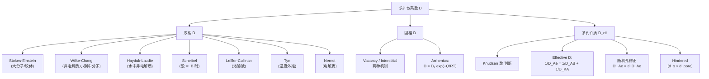

# 液相、固相、多孔扩散系数估算 / Estimation of Diffusion Coefficient (Liquid, Solid, Pore Diffusivity)

> [!abstract] 本节定位
> - **位置**: 第 4 周, L04
> - **前置**: [[L03_diffusion_coefficient_estimation]](气相 D 的估算 — Hirschfelder / Fuller / Brokaw / Wilke)
> - **本节核心**: L03 把"气相 D 怎么算"讲透了,L04 接力把另外三个场景一次性补完 — **液相**(经验式为主) / **固相**(Arrhenius) / **多孔介质**(Knudsen + 阻碍)。**学完这两讲,任何"求 D"的题都能开工。**
> - **后续联系**: 本讲产出的 D 会进入后面的 Fick 第二定律(瞬态扩散)、对流传质 Sh 关联、相间传质 (k_x/k_y) 和气液吸收等所有传质单元操作中。

---

## 知识结构



---

## 知识块 1 — 液相 D 的三个基本特点

液体扩散的理论比气体差很多,工程实践里 90% 靠 **经验关联式**。先把三件事记住:

1. **理论不成熟,实验数据少** — 不像气体有 Hirschfelder 这种从分子动力学严格推出来的式子,液相基本是半经验拟合。
2. **量级比气体小 4–5 个数量级** — 气体 ~10⁻⁵ m²/s,液体 ~10⁻⁹ m²/s。直觉:液体里分子贴得紧,扩散像挤地铁。
3. **可以以分子或离子形式扩散** — 例如 NaCl 溶于水后是 Na⁺ 和 Cl⁻ 两种粒子各自跑,处理方式和分子(乙醇、甲醇)不同 → 后面要分 Wilke-Chang(分子) vs Nernst(离子)。

> [!warning] 重要 caveat(PPT 备注)
> 液相 **D_AB ≠ D_BA**(乙醇在水中的扩散系数 ≠ 水在乙醇中)。气相里 Hirschfelder/Fuller 都默认 D_AB = D_BA,液相**不能这样**。下面的 Wilke-Chang、Stokes-Einstein 都是"A 在稀释 B 中"的方向,做题查表时务必看清查的是哪个方向。

---

## 知识块 2 — 液相扩散的两套物理图像

PPT 给了两种"为什么液体会扩散"的解释,**两套图像最终都汇到 Stokes-Einstein**:

### 图像 1:Eyring "hole" 理论(类晶格 + 跳跃)

把液体看成一个 **准晶格(quasi-crystalline lattice)**,但里面有不少**空穴(holes)**。溶质分子扩散的过程 = 不断从当前格子**跳进**邻近的空穴。

（vault 中此处为课件截图，示例仓库不附原图）
> 准晶格 + 空穴的初态示意:深紫色小球是溶质,周围蓝球是溶剂分子排成的"晶格"。

（vault 中此处为课件截图，示例仓库不附原图）
> 溶质跳进相邻空穴的动作。这种"跳跃"决定了 D 的大小 — 空穴越多、跳跃活化能越低,D 越大。这套图像后面在**固相扩散**(Vacancy)里几乎一模一样地复现。

### 图像 2:Hydrodynamical(流体动力学)理论

把溶质分子看成在连续介质里运动的**球体**,溶质迁移率(mobility) = 单位驱动力下的速度。给出**力 ↔ 速度**的关系 → 直接用 Stokes 阻力公式。

这条路得到的是 **Stokes-Einstein 方程**,适用条件最纯粹:**胶体或大球形分子在连续介质溶剂里**。

---

## 知识块 3 — Stokes-Einstein 方程

适用于**胶体颗粒 / 大圆球分子**在溶剂中扩散(溶剂分子相对溶质很小,可看作连续流体)。

$$
D_{AB} = \frac{k_B T}{6 \pi r \mu_B}
$$

| 符号 | 含义 | 单位 |
|---|---|---|
| $D_{AB}$ | A 在稀 B 中的扩散系数 | m²/s |
| $k_B$ | Boltzmann 常数 | $1.38 \times 10^{-23}$ J/K |
| $T$ | 绝对温度 | K |
| $r$ | 溶质球半径 | m |
| $\mu_B$ | 溶剂粘度 | kg/(m·s) = Pa·s |

**解读**: D 与温度成正比、与粘度+溶质半径成反比。直觉:溶剂越稠、溶质越大,扩散越慢。

> [!tip] 延伸(非 PPT 内容)
> Stokes-Einstein 来源于"扩散的随机布朗运动 = 被流体阻力平衡"。**对小分子(< Mw 400)它会**显著高估 D**,因为小分子尺寸跟溶剂分子可比,"连续介质"假设破产。这就是为什么下面要引入 Wilke-Chang。

---

## 知识块 4 — Wilke-Chang 方程(液相主力公式)

**适用条件**: 非电解质 + 无穷稀释溶液 + 溶质分子量小到中等(M_w < 400)。

$$
D_{AB} = \frac{7.4 \times 10^{-8} \, T \, (\Phi_B M_B)^{1/2}}{V_A^{0.6} \, \mu_B}
$$

> ⚠️ **混合 cgs 单位**:$D_{AB}$ [cm²/s], $T$ [K], $M_B$ [g/mol], $V_A$ [cm³/mol], $\mu_B$ [cP], $\Phi_B$ 无量纲。代入前必须先转单位,这是最容易出错的地方。

### 怎么查 V_A(溶质沸点处摩尔体积)

**方法 a — 查表**(常见小分子,Table 24.4):

| 化合物 | V_A (cm³/mol) | 化合物 | V_A (cm³/mol) |
| --- | ------------- | --- | ------------- |
| H₂  | 14.3          | H₂O | 18.9          |
| O₂  | 25.6          | NH₃ | 25.8          |
| N₂  | 31.2          | H₂S | 32.9          |
| Air | 29.9          | CO₂ | 34.0          |
| CO  | 30.7          | SO₂ | 44.8          |
| Cl₂ | 48.4          | Br₂ | 53.2          |

**方法 b — 加和原子贡献**(Table 24.5):溶质里有多少个 C、H、O、N…按原子体积加起来。常用值:

| 元素 | V (cm³/mol) | 元素 | V (cm³/mol) |
|---|---|---|---|
| C | 14.8 | O(一般) | 7.4 |
| H | 3.7 | O(甲基酯) | 9.1 |
| N(双键) | 15.6 | O(酸) | 12.0 |
| N(伯胺) | 10.5 | S | 25.6 |
| Cl | 21.6 | Br | 27.0 |
| I | 37.0 | | |

**环修正**(分子有环时要扣):

| 环 | 修正 |
|---|---|
| 三元环(环氧乙烷) | −6 |
| 四元环 | −8.5 |
| 五元环(呋喃) | −11.5 |
| 苯环、吡啶 | −15 |
| 萘环 | −30 |
| 蒽环 | −47.5 |

**方法 c — 临界体积估算**(没数据时):

$$
V_A = 0.285 \, V_c^{1.048}
$$

$$V_c = 物质 A 的临界体积 (cm³/mol)$$
### 怎么查 Φ_B(溶剂关联参数)

| 溶剂 | Φ_B |
|---|---|
| 水 | 2.26 |
| 甲醇 | 1.9 |
| 乙醇 | 1.5 |
| 苯、乙醚、庚烷等非缔合溶剂 | 1.0 |

**直觉**: 缔合性强的溶剂(水有氢键)Φ 更大,意味着对溶质迁移阻力更小(因为溶剂分子相互"绑住",不会挡溶质太多)。

---

## 知识块 5 — Hayduk-Laudie 方程(水里专用)

> 📌 PPT 原文拼成 "Kayduk and Laudie",**正确文献拼写是 Hayduk-Laudie**。

**适用**: 水溶剂 + 非电解质 + 无穷稀释。比 Wilke-Chang 简单 — 不要 $\Phi_B$、不要 $T$ 显式项(温度藏在 μ_B 里)。

$$
D_{AB} = 13.26 \times 10^{-5} \, \mu_B^{-1.14} \, V_A^{-0.589}
$$

| 符号 | 含义 | 单位 |
|---|---|---|
| $D_{AB}$ | A 在水中的扩散系数 | cm²/s |
| $\mu_B$ | 水的粘度 | cP |
| $V_A$ | 溶质沸点处摩尔体积 | cm³/mol |

**用法**: 当题目特别说"水溶液"且不想算 Wilke-Chang 时优先用。结果与 Wilke-Chang 通常相差 < 10%。

---

## 知识块 6 — Scheibel 方程(没 Φ_B 时的退路)

> 📌 PPT 原文拼成 "Scheibel"(没拼错,但要注意发音)。

**适用**: 非电解质 + 稀释,**当查不到 Φ_B 时**用它(把 Φ 因子从 Wilke-Chang 里消掉)。

$$
D_{AB} = \frac{K \, T}{\mu_B \, V_A^{1/3}}
$$

$$
K = 8.2 \times 10^{-8} \left[ 1 + \left( \frac{3 V_B}{V_A} \right)^{2/3} \right]
$$

**例外**(K 取常数,跳过括号项):

1. 苯做溶剂,且 $V_A < 2 V_B$:取 $K = 18.9 \times 10^{-8}$
2. 其他有机溶剂,且 $V_A < 2.5 V_B$:取 $K = 17.5 \times 10^{-8}$

V_B = 溶剂沸点处摩尔体积(同样查 Table 24.4 / 24.5)。

---

## 知识块 7 — Leffler-Cullinan 方程(浓溶液)

前面所有公式都默认**无穷稀释**。一旦溶质浓度高,溶质 - 溶质相互作用不能忽略,得用 Leffler-Cullinan:

$$
D_{AB} \, \mu = (D_{AB}^o \, \mu_B)^{x_B} \, (D_{BA}^o \, \mu_A)^{x_A}
$$

| 符号 | 含义 |
|---|---|
| $D_{AB}^o, D_{BA}^o$ | A 在稀 B 中、B 在稀 A 中的**无穷稀释**扩散系数 |
| $x_A, x_B$ | A、B 在溶液中的**摩尔分数** |
| $\mu, \mu_A, \mu_B$ | 混合液、纯 A、纯 B 的粘度 |

**用法**: 先用 Wilke-Chang 等算两个方向的稀释 D°,再加权合成混合浓度下的 D。

---

## 知识块 8 — Tyn 方程(温度外推)

> 📌 PPT 拼成 "Tyne",**文献正确拼写 Tyn**(Tyn-Calus)。

已知 T₁ 下的 D,要算 T₂ 下的 D,不用重头查表:

$$
\frac{D_{AB,T_1}}{D_{AB,T_2}} = \left( \frac{T_c - T_2}{T_c - T_1} \right)^n
$$

$T_c$ = 溶剂 B 的临界温度 (K)。**指数 n 由溶剂的蒸发焓决定**:

| ΔH_v (kJ/kmol) | n |
|---|---|
| 7,900–30,000 | 3 |
| 30,000–39,000 | 4 |
| 39,000–46,000 | 6 |
| 46,000–50,000 | 8 |
| > 50,000 | 10 |

**直觉**: 温度越接近临界点,D 变化越剧烈,所以分母用 (T_c − T)。蒸发焓越大(分子相互作用越强),n 越大,D 对 T 越敏感。

---

## 知识块 9 — Nernst 方程(电解质)

**所有上面这些都不能用于电解质**(NaCl、HCl 等)。离子在溶液里是带电的,扩散驱动力不只是浓度梯度,还有电场。

**适用**: 完全离解的**单价**(univalent)电解质 + 稀溶液。

$$
D_{AB} = \frac{2 R T}{\left( \dfrac{1}{\lambda_+^0} + \dfrac{1}{\lambda_-^0} \right) F^2}
$$

| 符号 | 含义 | 单位 |
|---|---|---|
| $D_{AB}$ | A 在 B 中的扩散系数 | cm²/s |
| $R$ | 气体常数 | 8.314 J/(mol·K) |
| $T$ | 绝对温度 | K |
| $\lambda_+^0, \lambda_-^0$ | 阳离子、阴离子的极限离子电导率 | A/cm² |
| $F$ | Faraday 常数 | 96,500 C/mol |

**多价盐**(如 CaCl₂、Al₂(SO₄)₃):把式子里的 **2 替换为** $\left( \dfrac{1}{n^+} + \dfrac{1}{n^-} \right)$,$n^+, n^-$ 分别是阳离子、阴离子的价数。

### 极限离子电导率表(25 °C 水中)

| 阳离子 | $\lambda_+^0$ | 阴离子 | $\lambda_-^0$ |
|---|---|---|---|
| H⁺ | 349.8 | OH⁻ | 197.6 |
| Li⁺ | 38.7 | Cl⁻ | 76.3 |
| Na⁺ | 50.1 | Br⁻ | 78.3 |
| K⁺ | 73.5 | I⁻ | 76.8 |
| NH₄⁺ | 73.4 | NO₃⁻ | 71.4 |

**注意**: H⁺ 和 OH⁻ 的电导率显著大于其他离子(因为水中的 Grotthuss 质子跳跃机制),所以**酸碱在水里扩散远比盐快**。

---

## 知识块 10 — 液相 D 选哪个公式?决策树

```
是电解质吗?
├─ 是 → Nernst(单价直接用,多价改系数)
└─ 否(非电解质)
    │
    ├─ 浓溶液? → Leffler-Cullinan(先算两个稀释方向 D°)
    │
    └─ 稀溶液
        │
        ├─ 大分子/胶体(溶质 >> 溶剂分子) → Stokes-Einstein
        │
        ├─ M_w < 400 + 知道 Φ_B → Wilke-Chang ⭐ 主力
        │
        ├─ 水溶剂 + 非电解质 → Hayduk-Laudie (与 Wilke-Chang 二选一)
        │
        ├─ 不知道 Φ_B → Scheibel
        │
        └─ 已知一个 T 下的 D,要换 T → Tyn
```

---

## 知识块 11 — 固相扩散:两种机制

固体里也有扩散,虽然慢得多。最常见的两个工程场景:
- **半导体掺杂**:把 B(硼)、P(磷)、As(砷)等掺进硅,改变导电性
- **钢渗碳**:碳原子扩散进铁里,使表面变硬(刀剑、齿轮)

固相扩散的微观机制有两种:

### 机制 1:Vacancy(空位)扩散

晶格不是完美的,总会有空位(缺一颗原子的位置)。**扩散原子从当前格子"跳进"相邻空位**,然后空位移到新位置。

（vault 中此处为课件截图，示例仓库不附原图）
> 蓝球晶格中间一行少了一个 → 空位。原子要跳到这个空位,得先**推开周围邻居**。这要消耗能量(活化能 Q),且会扭曲晶格。所以扩散速率取决于**空位密度** × **跳跃活化能**(典型 Q ~ 100–300 kJ/mol)。

### 机制 2:Interstitial(间隙)扩散

间隙位 = 晶格大原子之间的缝隙。**小原子(如 C、H、N)**直接占据间隙,不用挤掉大原子,只需轻微撑大邻居。

（vault 中此处为课件截图，示例仓库不附原图）
（vault 中此处为课件截图，示例仓库不附原图）
> 上图:小红球处于左侧间隙位。下图:跳到了相邻的间隙位。**比 vacancy 快得多**,因为 (a) 间隙位比空位多,(b) 不用推开邻居,只是撑开。

**典型例子**:钢里的 C(碳)、N(氮)、H(氢)都走 interstitial — 它们小到能塞进 Fe 晶格缝隙里。

---

## 知识块 12 — Arrhenius 形式 + 数据表

不管是 vacancy 还是 interstitial,固相 D 都遵循 **Arrhenius 形式**(温度越高跳得越频繁):

$$
\boxed{D_{AB} = D_0 \, e^{-Q/RT}}
$$

取对数后是直线方程(便于拟合):

$$
\ln D_{AB} = -\frac{Q}{R} \cdot \frac{1}{T} + \ln D_0
$$

| 符号 | 含义 |
|---|---|
| $D_0$ | 频率因子(prefactor) |
| $Q$ | 活化能 (J/mol) |
| $R$ | 8.314 J/(mol·K) |
| $T$ | 绝对温度 (K) |

### 怎么从实验数据拟合 Q 和 D₀

把 $\ln D$ vs $1/T$(或 $1000/T$)画散点 + 线性拟合,**斜率 = −Q/R**,**截距 = ln D₀**:

（vault 中此处为课件截图，示例仓库不附原图）
> 上图横轴 1/T(单位 K⁻¹),拟合得 y = −118.26 x + 0.2426;下图横轴 1000/T(单位 1000 K⁻¹),斜率变成 −0.1183。**两个图斜率差 1000 倍 — 用哪个横坐标算 Q 时务必把单位换算清楚**:

- 用 1/T 做横轴:Q = −斜率 × R = 118.26 × 8.314 ≈ **983 J/mol**
- 用 1000/T 做横轴:Q = −斜率 × 1000 × R(因为 d(1/T)/d(1000/T) = 1/1000)

### 半导体掺杂的 Arrhenius 图(应用案例)

（vault 中此处为课件截图，示例仓库不附原图）
> Si 中各种掺杂剂的 D vs 1000/T:Sb、In、Ga、Al、B、P 五条直线,斜率(= −Q/R)各不相同。**这种图工业上用来选工艺温度** — 比如想要 D ~ 10⁻¹² cm²/s,从 y 轴查横线,看与目标元素的交点,读出对应温度。

### 典型数据表(查表必备)

**自扩散金属(Table 24.6)**:

| 结构 | 金属 | $D_0$ (mm²/s) | $Q$ (kJ/mol) |
|---|---|---|---|
| fcc | Au | 10.7 | 176.9 |
| fcc | Cu | 31 | 200.3 |
| fcc | Ni | 190 | 279.7 |
| fcc | Fe(γ) | 49 | 284.1 |
| bcc | Fe(α) | 200 | 239.7 |
| bcc | Fe(δ) | 1980 | 238.5 |

**铁中的间隙固溶元素(Table 24.7)**:

| 结构 | 溶质 | $D_0$ (mm²/s) | $Q$ (kJ/mol) |
|---|---|---|---|
| bcc | C | 2.0 | 84.1 |
| bcc | N | 0.3 | 76.1 |
| bcc | H | 0.1 | 13.4 |
| fcc | C | 2.5 | 144.2 |

> [!tip] 延伸(非 PPT 内容)
> 注意 **H 在 bcc 铁里 Q 只有 13.4 kJ/mol**,远低于其他元素(C 是 84.1) — 这就是**氢脆**(Hydrogen Embrittlement)的根源:H 在常温下也能很快扩散到铁里,聚集到晶界处导致材料脆化。这是高强钢、压力容器最头疼的失效模式之一。

---

## 知识块 13 — 多孔扩散(1):什么时候 Knudsen 起作用

催化剂、吸附剂、膜 — 这些**多孔材料**里气体怎么扩散?有两个机制:

- **分子扩散(普通 D_AB)**: 分子之间相互碰撞为主
- **Knudsen 扩散**: 分子主要**撞墙**(撞孔壁),不是撞彼此

哪个起作用,取决于**分子平均自由程 λ vs 孔径 d_pore** 的相对大小。

### Knudsen 数

$$
Kn = \frac{\lambda}{d_{\text{pore}}} = \frac{\text{平均自由程}}{\text{孔径}}
$$

- $Kn < 1$: 分子之间互撞为主 → 用普通 D_AB
- $Kn > 1$: **撞墙为主 → Knudsen 扩散重要**
- $Kn ≈ 1$: 两者都重要 → 需要混合公式(下一块)

**Kn 增大的条件**: **压力↓**(λ 增大) 或 **温度↑**(分子跑得快但同时密度变小,综合 λ ↑) 或 **孔径↓**。这就是**真空 + 微孔**最容易触发 Knudsen — Example 4 正是这种情况(100 Pa,10 μm 孔)。

### Knudsen 扩散系数公式

从气体动理论的自扩散公式 $D_{AA^*} = \dfrac{\lambda u}{3}$ 出发,把 λ 替换成 d_pore(因为现在限制扩散的是孔径):

$$
D_{KA} = \frac{d_{\text{pore}}}{3} \, u = \frac{d_{\text{pore}}}{3} \sqrt{\frac{8 k_B N T}{\pi M_A}}
$$

代入 Boltzmann 常数 $k_B = 1.38 \times 10^{-16}$ g·cm²/(s²·K) 和 Avogadro 数 N,得**工程实用形式**:

$$
\boxed{D_{KA} = 4850 \, d_{\text{pore}} \sqrt{\frac{T}{M_A}}}
$$

| 符号 | 含义 | 单位 |
|---|---|---|
| $D_{KA}$ | Knudsen 扩散系数 | cm²/s |
| $d_{\text{pore}}$ | 孔径 | cm |
| $T$ | 温度 | K |
| $M_A$ | A 的摩尔质量 | g/mol |

**记忆口诀**: D_KA 与 d_pore 成正比(孔越大撞墙越少越好走) + 与 √(T/M) 成正比(分子越快越轻越好走) + 与 P **无关**(因为 Knudsen 已经不靠分子互撞)。

---

## 知识块 14 — 多孔扩散(2):Effective diffusivity 总公式

实际孔里两种机制经常**同时存在**(中等 Kn)。**两种阻力串联**(类似电阻串联):

$$
\frac{1}{D_{Ae}} = \frac{1 - \alpha y_A}{D_{AB}} + \frac{1}{D_{KA}}
$$

$$
\alpha = 1 + \frac{N_B}{N_A}
$$

**简化**: 当 $\alpha = 0$(等摩尔反向扩散,N_A = −N_B)或 **y_A 很小**(稀释)时:

$$
\boxed{\frac{1}{D_{Ae}} = \frac{1}{D_{AB}} + \frac{1}{D_{KA}}}
$$

这个式子假设孔是**直的、平行排列的圆柱**。

### 随机孔(更现实的情况)

真实多孔材料里,孔**扭曲互联**(tortuous + interconnected)。有两个修正:

$$
D_{Ae}' = \varepsilon^2 \, D_{Ae}
$$

$$
\varepsilon = \frac{\text{孔体积}}{\text{多孔固体总体积}} = \text{孔隙率(void fraction)}
$$

ε² 同时包含了两个效应(粗略地):
- **可用横截面缩小**(只有 ε 比例的截面是孔) → 一个 ε
- **路径变长 + 弯曲**(tortuosity τ 大约 ~ 1/ε) → 另一个 ε

> [!tip] 延伸(非 PPT 内容)
> 更严谨的写法是 $D_{Ae}' = \dfrac{\varepsilon}{\tau} D_{Ae}$,其中 τ ~ 2–5(典型工业催化剂)。**ε² 是 τ ≈ 1/ε 的简化**。两种写法在做题时都见得到,看清题目给什么。

### 一图总览四种孔扩散场景

（vault 中此处为课件截图，示例仓库不附原图）
> A、B 两种分子在孔里既互撞又撞壁。这一张图概括了"什么时候用哪个公式"的判断:
> - 大孔 + 高压 → 纯分子扩散 $D_{AB}$(L03 的 Hirschfelder/Fuller)
> - 小孔 + 低压 → 纯 Knudsen $D_{KA}$
> - 中间 → Effective $D_{Ae}$
> - 加上扭曲随机 → $D_{Ae}' = \varepsilon^2 D_{Ae}$

---

## 知识块 15 — Hindered Diffusion(液相 + 孔径接近溶质大小)

**场景**: 不再是气体在多孔里,而是**液体填满了孔**,且**溶质分子跟孔径差不多大**(d_s 接近 d_pore)。这时溶质即使能进孔,也被"卡得很紧",移动速度大幅减慢。**生物分离常见**(蛋白质过滤、凝胶过滤色谱)。

### 主公式

$$
D_{Ae} = D_{AB}^o \, F_1(\varphi) \, F_2(\varphi)
$$

| 符号 | 含义 |
|---|---|
| $D_{AB}^o$ | A 在 B 中的**无穷稀释**扩散系数(由 Wilke-Chang / Stokes-Einstein 给出) |
| $F_1, F_2$ | 修正因子 (0–1 之间) |

### Reduced pore diameter(无量纲)

$$
\varphi = \frac{d_s}{d_{\text{pore}}} = \frac{\text{溶质分子直径}}{\text{孔径}}
$$

- $\varphi > 1$: **溶质太大,完全进不去孔** — solute exclusion(分子筛效应)。**这正是用来分离大蛋白的原理。**
- $0 \le \varphi \le 0.6$: F₁ F₂ 公式适用,有一定阻碍
- $0.6 < \varphi \le 1$: 阻碍极强,F₂ 公式准度下降

### F₁ — 立体分配因子(Steric Partition Coefficient)

> 📌 PPT 标题拼成 "Stearic",**正确拼写是 Steric**(立体的)。

$$
F_1(\varphi) = \frac{\text{溶质能进入的截面}}{\text{孔总截面}} = \frac{\pi(d_{\text{pore}} - d_s)^2}{\pi d_{\text{pore}}^2} = (1 - \varphi)^2
$$

物理意义:**溶质球心**只能落在距孔壁至少 $d_s/2$ 的内部环里,所以可用截面缩小成 $(d_{\text{pore}} − d_s)^2 / d_{\text{pore}}^2 = (1−\varphi)^2$。

### F₂ — 流体动力学阻碍因子(Hydrodynamic Hindrance Factor)

$$
F_2(\varphi) = 1 - 2.104 \varphi + 2.09 \varphi^3 - 0.95 \varphi^5
$$

**适用**: 刚性球形溶质 + 直圆柱孔 + $0 \le \varphi \le 0.6$。

物理意义:即使溶质能进孔,它在孔内移动时**受孔壁的额外粘性阻力**(Stokes 流体动力学计算给出)。φ 越大,F₂ 越小(0 接近)。

> [!tip] 延伸(非 PPT 内容)
> 这个多项式系数 (−2.104, 2.09, −0.95) 来自 Renkin (1954) 对刚性球在圆柱孔内 Stokes 流的级数展开。文献里也有更精细的 Bungay-Brenner (1973) 形式,系数稍有不同但思想一致。

---

## 知识块 16 — 例题导览(详细解算见 T04)

PPT 给了 5 道例题,精确解算放到对应 tutorial,这里只列**思路**:

### Example 1 — Wilke-Chang 标准操练

> 在 10 °C 下、稀水溶液中,估算乙醇的液相扩散系数。已知溶液粘度 1.45 cP。

**思路**: A=乙醇,B=水。查 Φ_B(水)= 2.26;查 V_A(乙醇,加和原子贡献:2C + 6H + O = 2×14.8 + 6×3.7 + 7.4 = 59.2);代 Wilke-Chang。

### Example 2 — Scheibel(没 Φ_B 时)

> 重做 Example 1,但假设查不到关联参数。

**思路**: 用 Scheibel,K 含 V_B(水)= 18.9;判断 V_A vs 2.5 V_B = 47.25,看是否触发 K = 17.5×10⁻⁸ 例外。

> ⚠️ PPT 题干笔误:写的是 "in Example 2",应为 "in Example 1"。

### Example 3 — Tyn 温度外推

> 用 Appendix Table J2,估算 400 K、0.01 mol/L 醋酸在水中的 D。已知水 ΔH_v(沸点)= 40656 J/mol,T_c(水)= 647.4 K。

**思路**: 表里给的是 25 °C 数据,要外推到 400 K(高于水沸点!这其实是过冷状态用插值预测,工程实践)。ΔH_v = 40.66 kJ/mol → 在 39,000–46,000 区间 → n = 6;代 Tyn 公式。

### Example 4 — 光纤里的 Knudsen + 分子混合扩散

> CVD 工艺:SiH₄(g) → Si(s) + 2 H₂(g) 在 10 μm 内径的玻璃光纤内表面发生,900 K、100 Pa,SiH₄ 在 He 载气中 1 mol%。给出 25 °C 1 atm 下 D_SiH₄,He = 0.571 cm²/s,σ = 4.08 Å,ε/k = 207.6 K,M = 32 g/mol。求 D_eff。

（vault 中此处为课件截图，示例仓库不附原图）
> 光纤剖面:中间有 d_pore = 10 μm 的孔,内壁被 Si 镀层覆盖,SiH₄+He 气体在 900 K、100 Pa 下流过。

**思路**:
1. 先用 Hirschfelder(L03)把 D_AB 从 25°C 1 atm 修到 900 K 100 Pa(乘 (T/T₀)^1.5 × P₀/P)
2. 用 Knudsen 公式算 $D_{KA} = 4850 d_{\text{pore}} \sqrt{T/M_A}$(注意 d_pore 单位转 cm)
3. 比较两者量级 → 算 Knudsen 数确认重要性
4. 串联式得 $1/D_{Ae} = 1/D_{AB} + 1/D_{KA}$(因为反应化学计量 N_A : N_B = 1:−2,α 不为 0,严格要用全式)

### Example 5 — Hindered diffusion 分离两种酶

> 用 30 nm 凝胶过滤膜分离溶菌酶 A(d_s = 4.12 nm,M = 14100)和过氧化氢酶 B(d_s = 10.44 nm,M = 250000)。298 K 下分离因子 α = D_Ae / D_Be = ?

（vault 中此处为课件截图，示例仓库不附原图）
> 30 nm 圆柱孔。A 球小(4.12 nm,φ_A = 0.137 → 阻碍轻),B 球大(10.44 nm,φ_B = 0.348 → 阻碍重)。**两者通过孔的速度不同,产生分离效果**。

**思路**:
1. 用 Stokes-Einstein 算 D°_AB 和 D°_BA(298 K,水 μ = 0.89 cP)
2. 算 φ_A、φ_B
3. 各算 F_1(φ) F_2(φ)
4. α = D_Ae/D_Be = (D°_A · F_1A · F_2A) / (D°_B · F_1B · F_2B)

---

## 对比与总结(本讲核心公式速查)

| 场景 | 公式 | 关键条件 |
|---|---|---|
| 液相·胶体/大球 | $D = kT / (6\pi r \mu)$ Stokes-Einstein | r >> 溶剂分子 |
| 液相·小到中分子 | $D = 7.4 \times 10^{-8} T (\Phi_B M_B)^{1/2} / (V_A^{0.6} \mu_B)$ Wilke-Chang | M_w < 400, 稀, 非电解质 |
| 液相·水中非电解质 | $D = 13.26 \times 10^{-5} \mu_B^{-1.14} V_A^{-0.589}$ Hayduk-Laudie | 水溶剂 |
| 液相·没 Φ_B | Scheibel | 替代 Wilke-Chang |
| 液相·浓溶液 | Leffler-Cullinan | 已知两个稀释方向 D° |
| 液相·温度外推 | $D_1/D_2 = ((T_c-T_2)/(T_c-T_1))^n$ Tyn | 已知一个 T 下的 D |
| 液相·电解质 | $D = 2RT / [(1/\lambda_+^0 + 1/\lambda_-^0) F^2]$ Nernst | 单价完全离解 |
| 固相 | $D = D_0 e^{-Q/RT}$ Arrhenius | 查 Q, D_0 表 |
| 多孔·Knudsen | $D_{KA} = 4850 d_{\text{pore}} \sqrt{T/M_A}$ | Kn > 1 |
| 多孔·混合 | $1/D_{Ae} = 1/D_{AB} + 1/D_{KA}$ | 直圆柱孔 |
| 多孔·随机 | $D_{Ae}' = \varepsilon^2 D_{Ae}$ | tortuous |
| 多孔·液相阻碍 | $D_{Ae} = D_{AB}^o F_1(\varphi) F_2(\varphi)$ | d_s ≈ d_pore |

---

## 本节引入的核心概念

<!-- seed-concept skill populates this list automatically. -->

- [[Stokes-Einstein 方程]]
- [[Wilke-Chang 方程]]
- [[Nernst 方程]]
- [[Arrhenius 形式扩散]]
- [[Knudsen 扩散]]
- [[Effective diffusivity]]
- [[Hindered diffusion]]
- [[孔隙率 ε]]
- [[迂曲度 tortuosity]]

---

## 我的疑问

> [!question]
> 1. **Wilke-Chang 是 cgs 混合单位**(cm²/s, cP, cm³/mol),实操时怎么和 SI 协调最不容易出错?有没有"先 SI 再换"或"先 cgs 再换"的最佳实践?
> 2. **Stokes-Einstein 里的 r** 应该取哪种半径(范德华半径、水合半径、还是 Lennard-Jones σ)?对蛋白质这种"近球"的大分子,文献里常给"水合半径",这是怎么定义的?
> 3. 多孔的 $\varepsilon^2$ vs $\varepsilon/\tau$ — 工业催化剂的 τ 典型值是多少?哪种写法更"靠谱"?教材为什么直接用 ε² 简化?
> 4. **Hindered diffusion 的 F₂ 多项式系数**(−2.104, 2.09, −0.95)从哪来? 老师有没有给原始文献(Renkin / Bungay-Brenner)? 这个公式对蛋白(非刚性球)还能用吗?
> 5. **液相 D_AB ≠ D_BA** — 课件给的"乙醇在水"和"水在乙醇"差几倍? 我能不能用 Stokes-Einstein(对称的!)来粗算两个方向,看会不会自相矛盾?
> 6. 半导体掺杂的 Q 量级(几百 kJ/mol)对应工艺温度大概是多少 °C? 这就是为什么硅器件做掺杂要用 1000 °C 量级炉子的原因吗?

---

## 个人补充

> [!note] 我的理解
> (上完课后填:课堂上听到的、想到的、和其他课联系起来的内容)

---

> [!info]- PPT 原文(Slides 1–48)
> **Slides 1–4 (封面 + 概览)**: CME 222 Mass Transfer / Diffusive Mass Transfer / （讲师） / 本讲覆盖液相、固相、多孔扩散系数估算 / 液相理论不成熟、量级 4-5 数量级低于气体、可分子或离子扩散
> **Slides 5–6 (理论起点)**: Eyring "hole" theory(准晶格 + 跳跃)/ Hydrodynamical theory(mobility + 力 ↔ 速度 → Stokes-Einstein)
> **Slide 7**: Stokes-Einstein D = kT/(6πrμ_B),适用胶体/大圆球
> **Slides 8–13**: Wilke-Chang 公式 + Table 24.4 分子体积 + Table 24.5 原子体积 + 环修正表 + V_A = 0.285 V_c^1.048 + Φ_B 关联参数表
> **Slide 14**: Example 1(乙醇在水中,10 °C, μ = 1.45 cP)+ caveat: D_AB ≠ D_BA
> **Slide 15**: Hayduk-Laudie(PPT 拼成 Kayduk)
> **Slide 16**: Scheibel + 两条 K 例外
> **Slide 17**: Example 2(没 Φ_B 时重算 ethanol-water)
> **Slide 18**: Leffler-Cullinan(浓溶液)
> **Slide 19**: Tyn(PPT 拼成 Tyne)+ ΔH_v→n 表
> **Slide 20**: Example 3(醋酸-水 400 K)
> **Slide 21**: Nernst(单价 + 多价系数替换)
> **Slide 22**: Limiting Ionic Conductances 表(25 °C 水)
> **Slides 23–24 (固相章节起始)**: 固相扩散 — 半导体/钢渗碳应用 + vacancy/interstitial 两机制
> **Slide 25**: Vacancy diffusion 概念图
> **Slide 26**: Interstitial diffusion 跳跃前后图
> **Slide 27**: Arrhenius 形式 D = D_0 exp(−Q/RT)
> **Slide 28**: Si 中各掺杂剂的 Arrhenius 多线图(Sb/In/Ga/Al/B,P)
> **Slide 29**: Arrhenius 拟合演示(1/T 与 1000/T 两种横轴的散点 + 直线)
> **Slide 30**: Table 24.6 自扩散金属数据 + bcc/fcc 晶胞
> **Slide 31**: Table 24.7 铁中间隙固溶体数据
> **Slides 32–33 (多孔章节起始)**: 多孔扩散 / Knudsen 扩散概念(λ < d_pore 时撞墙为主)
> **Slide 34**: Knudsen 数 Kn = λ/d_pore,Kn 增大于 P↓T↑
> **Slide 35**: Knudsen 扩散公式推导 → D_KA = 4850 d_pore √(T/M)
> **Slide 36**: Effective diffusivity 总公式 + α = 1 + N_B/N_A,简化为 1/D_Ae = 1/D_AB + 1/D_KA
> **Slide 37**: Random pores ε² 修正
> **Slide 38**: 四象限总图(纯分子 / 纯 Knudsen / 混合 / 随机孔)
> **Slide 39**: Example 4(SiH₄ 在 10 μm 光纤内 CVD)+ 光纤剖面图
> **Slide 40**: Hindered diffusion 概念
> **Slide 41**: D_Ae = D°_AB F_1 F_2 + φ = d_s/d_pore + φ > 1 时 solute exclusion
> **Slide 42**: F_1 = (1−φ)² + F_2 = 1 − 2.104φ + 2.09φ³ − 0.95φ⁵(PPT "Stearic" 实为 Steric)
> **Slide 43**: Example 5(凝胶过滤膜分离溶菌酶 + 过氧化氢酶)
> **Slides 44–48 (Take Home Message)**: 公式速查 — Stokes-Einstein / Wilke-Chang / Hayduk-Laudie / Scheibel / Leffler-Cullinan / Tyn / Solid Arrhenius / Knudsen / Effective(直孔 + 随机孔)/ Hindered diffusion
