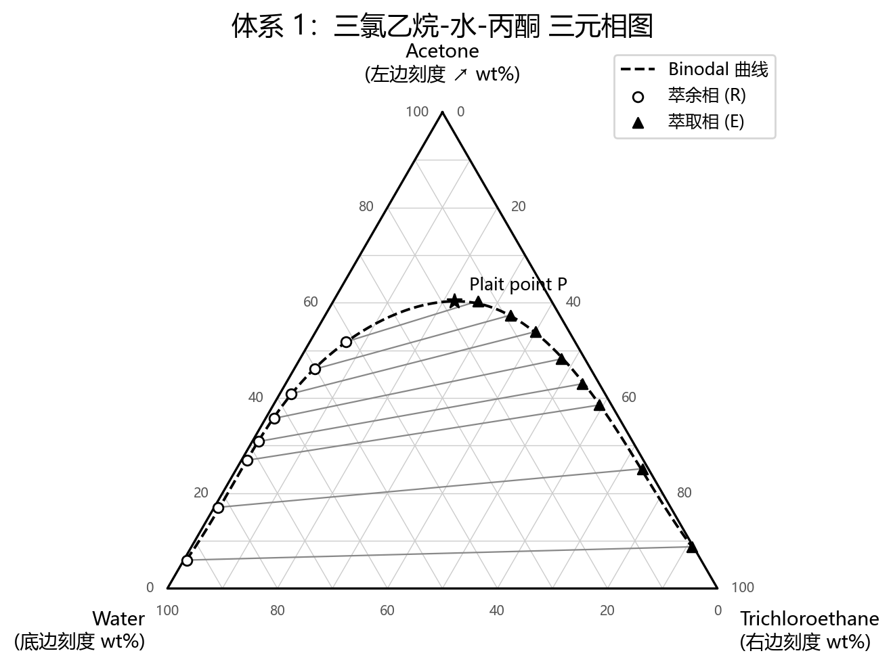
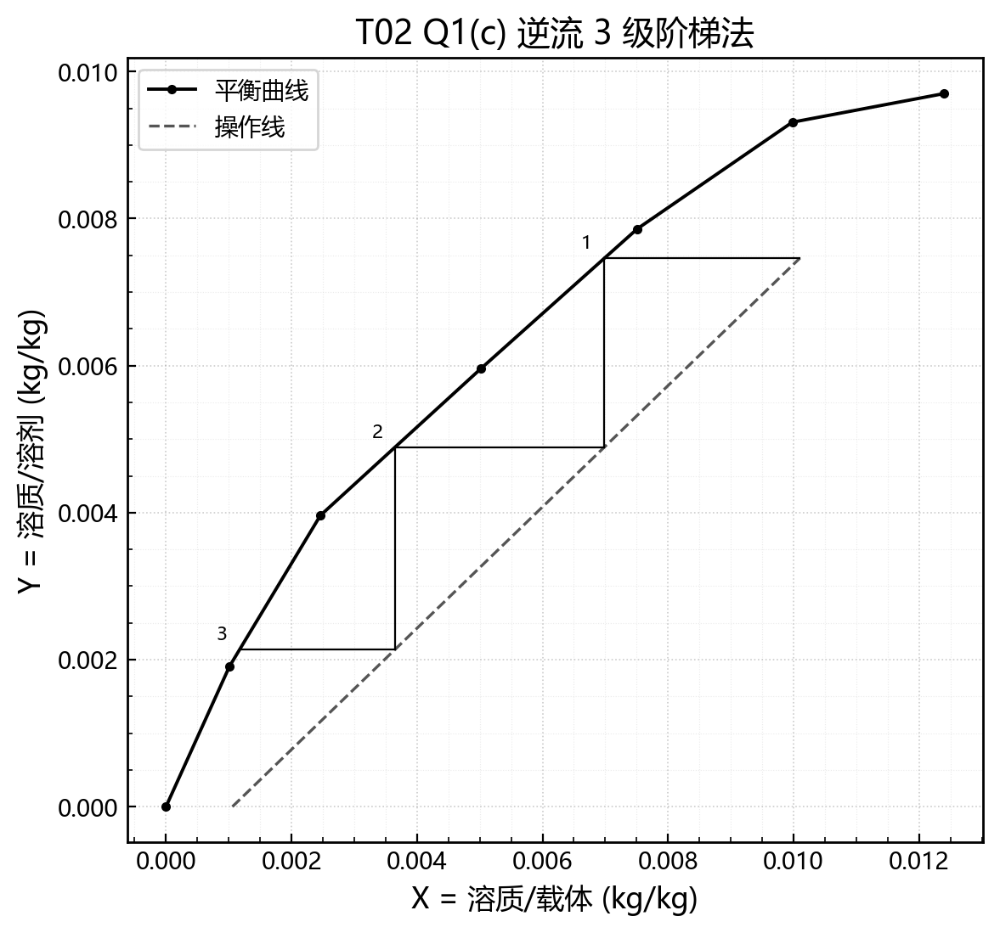
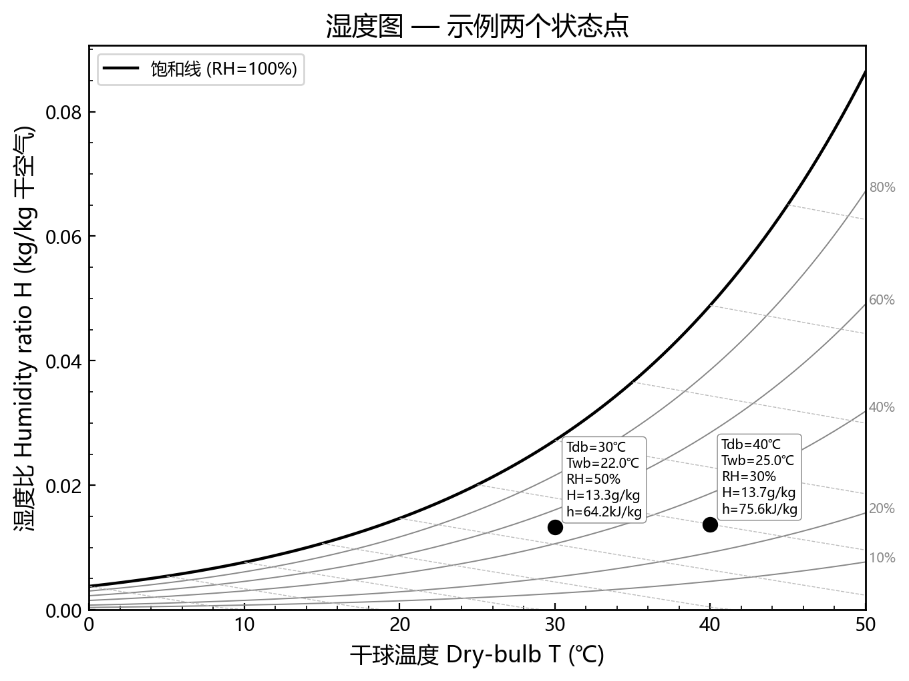

# chemeng-coursework

**化工作业助手 · 领域插件参考实现** — a chemical-engineering homework companion, and the worked example of how to build a domain plugin on top of the framework layer.

The design goal is the opposite of a ghostwriter: **you make the decisions and write the prose; the AI lays out the options, then does the calculation, verification and formatting.**

<p align="center">
  
  
  
</p>
<p align="center"><sub>Generated by the bundled plotting library: ternary diagram with tie lines · countercurrent stage stepping · psychrometric chart.</sub></p>

## Skill: `homework-coach`

| You say | Mode | What happens |
|---|---|---|
| "帮我算这道题" / "做这份 tutorial" | **A · Study partner** (default) | The AI first writes a **decision briefing**: unknowns, the candidate methods taught in the course, when each applies. You choose method and assumptions — then it calculates, checks units, magnitudes and balances, and formats. It reviews your paragraphs but does not write them. |
| "从 0 做整份小组报告" / "整份 lab report 帮我做" | **B · Full report** (explicit opt-in) | A complete draft — calculations, figures, text, APA references, formatting — with multi-agent review and built-in guardrails. |

Mode B only runs when you ask for it in so many words; everything else stays in Mode A.

Each assignment gets a reproducible folder:

```text
01_Projects/<CODE>_<course>/_drafts/<assignment>/
├── task.md        problem statement + given parameters
├── decisions.md   every decision point and what you chose
├── calc.py        re-runnable calculation script
├── output.txt     results with units and closure checks
├── figures/       only if the problem asks for plots
├── draft.md       your text (AI reviews, does not write)
└── final.docx     formatted output
```

## Bundled tools

| Script | Purpose |
|---|---|
| `scripts/chemeng_plots.py` | Graphical methods for separations: `plot_ternary`, `plot_distribution`, `plot_mccabe_thiele`, `plot_lle_d_system`, `plot_sle_right_triangle`, `plot_drying_curve`, `plot_filtration_linear`, `plot_psychrometric_chart`, plus `lever_rule`, `falling_rate_integral` and a coordinates table for every plot |
| `scripts/plot_pro.py`, `plot_setup.py` | Consistent publication-style figures (fonts, grids, CJK labels) |
| `scripts/docx_polish.py`, `format_compliance.py`, `assemble_template.py` | Markdown → docx polishing: fonts, three-line tables, figure centring, page numbers, course template |
| `scripts/examples_cme214.py` | Regenerates every figure in `scripts/figures/` |

Detailed rules live in `skills/homework-coach/references/` (decision briefing protocol, plot style, docx format, report builder and review agents).

Plotting needs `matplotlib numpy`; psychrometric charts add `psychrolib`; docx polishing needs `python-docx`.

## Use it as a template for your own field

This plugin is deliberately thin: it holds only domain knowledge (methods, plotting conventions, report formats) and reuses the framework for everything else. To add law, medicine, music or any other subject, copy this folder and follow [`docs/PLUGIN_SPEC.md`](../../docs/PLUGIN_SPEC.md).
